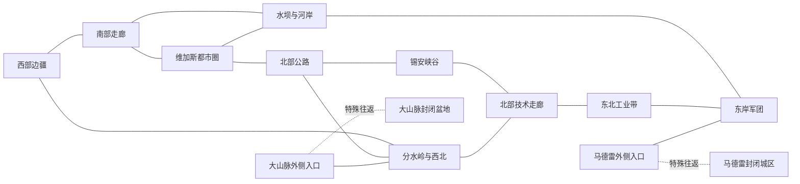

# 战役地图设计

更新日期：2026-11-06。状态：战区、省份聚落与四省前线开局接口初设；已确认原则保持原效力，助手初设与候选不因写入自动定稿。技术状态以责任报告和工程记录为准。

本文由世界与战役职责维护。战区原则见第二节，省份与聚落见第六节，前线细化见第七节；本领域当前进展、依赖与下一步统一见第八节。返回[设计总纲](../设计总纲.md)。

## 二、统一地图与已展开方案

以下使用架空关系与位置，不作为原作政治、年代或精确地理说明；地图采用用户已确认的架空拼接方式，以新维加斯及四个地区为骨架向外扩展；具体边界与连接继续设计。仅考虑单人战役。

### 2.1 设计边界

战区、连接和势力开局均按候选方案组织。架空拼接、单人、大地图多势力，以及大山脉／马德雷的地形隔离与特殊入口，是用户已确认方向；下列分区、连接、起点和奖励组合为助手初设，可继续修改。具体坐标与地图实现待定。

采用“莫哈维战争尚未决出胜负，各指挥集团已独立行动”的架空格局。NCR 与军团各自存在多个指挥中心，中央权威不直接吞并全部开局。全系列组织可以迁入相邻扩展战区，不以现实北美距离拉长行军。

### 2.2 战区划分与功能

R编号表示规划区，不是一个省份或一个聚落。一个规划区后续可包含多个省份与地方派系，数量由路线、密度和制作条件决定。

| 编号 | 规划区 | 地图作用与地形方向 | 势力布置候选 |
| --- | --- | --- | --- |
| R01 | 西部边疆与共和国门户 | NCR纵深、山口与多条交通线；避免一个入口被堵后全区失去交互 | 汉隆集团、NCR地方守备、大汉帮西部据点、掠夺者 |
| R02 | 南部交通走廊 | NCR进军维加斯和前线的通路，地方城镇形成支线战争 | 摩尔集团后方、炸药帮、地方民兵和商贸城镇 |
| R03 | 维加斯都市圈 | 单省四城；豪斯／好好先生互斥选择同一幸运38开局 | 豪斯／好好先生、三赌场家族、猫王帮与恶魔帮；麦卡伦为外围NCR接应据点 |
| R04 | 水坝与河岸前线 | 多渡口、多方向进攻；水坝重要，但不是整条战线唯一过河口 | NCR前线、拉尼乌斯前锋、地方守备 |
| R05 | 东岸军团疆域 | 军团纵深与侧翼出发地；前线集团不会开局挤在同一点 | 拉尼乌斯主据点、武尔佩斯、普通军团与附属部落 |
| R06 | 北部公路与荒野 | 连接都市、锡安及外缘，提供较开放的地方战争 | 大汉帮、塔比莎、雅各布斯镇、Boomers、掠夺者 |
| R07 | 锡安峡谷群 | 山地支路与部落争夺，通向主地图和外缘，不作为封闭剧情区 | 白腿、死马、悲伤部落；格雷厄姆当前归位引用6.2节 |
| R08 | 大分水岭与西北废土 | 军事遗产与危险通路，连接西部和北方，形成另一条战线 | 尤利西斯不可玩、无野战军强驻军；主教在相邻旧军事带 |
| R09 | 北部技术走廊 | 科技设施、坚固据点与扩展空间，承接高技术派系冲突 | 英克雷复归集团、兄弟会分部、技术设施守军 |
| R10 | 东北聚落与工业带 | 跨系列势力进入统一地图的主要空间；工业、城镇和荒野交错 | 学院F37可玩、义勇军F35与独立地方聚落、枪手等；铁路F36使用隐藏网络，阿卡迪亚F40候选不新增地区 |
| R11 | 大山脉封闭盆地 | 不可跨越地形围合；仅特殊入口连接主地图；内部有真实城镇与设施 | F21智脑联合体与F42莫比乌斯，两可玩派系共享基础内容 |
| R12 | 马德雷封闭城区 | 不可跨越地形围合；仅特殊入口连接主地图；单省唯一城，赌场攻占后爆炸成为废墟 | 以利亚及指定人物强驻军，幽灵人与全息守卫 |

尸鬼科学家／火箭分支、塞拉斯政权、兄弟会主堡垒及分部、死亡爪女王（F24，架空）均已在6.2节工作样本中列出位置；具体聚落只在该表维护，不为安置单个领主新建独立大区。上述地点均为Mod架空安排，不声称符合原作地理。

### 2.3 地区连接草图

实线表示普通陆路的规划连接，虚线表示唯一类型的特殊出入连接；不表示地图坐标、道路数量或回合距离。主地图形成数个相连环路，大山脉和马德雷则是各自独立的封闭区域。图中入口外侧应是可接近、可争夺的实际陆地区域。地理相邻关系见2.4节，图中连线只表达通行关系。

大山脉入口优先放在分水岭侧，使西部、北部与技术派系都有争夺机会；马德雷入口优先放在军团东岸外缘，使东岸有水坝之外的进攻目标。具体外侧地区与内侧落点见6.3节，不自动添加一套入口建筑链。本图仅是该通行骨架的R级概览，不另定道路或入口。

### 2.4 大山脉与马德雷的封闭区域功能初设

**已确认地理：**R12马德雷赌场与R11大山脉相邻，均为本战役真实领土，由不可跨越地形围合并经各自特殊入口出入。具体边界、方位和安全落点待落图。

| 区域 | 当前规则 | 入口与占领权限 |
| --- | --- | --- |
| 大山脉 | F21智脑与F42莫比乌斯关系差但开局和平，AI倾向维持现状并建设防御；本族玩家可先经营、清理失控据点，再选择内部统一。统一后智脑倾向扩张，莫比乌斯以守成及危险技术追踪为主 | 统一前当地两派禁止外出，外部军队可进入及退出，外来玩家首次进入按事件四选一确定外交；外部AI不主动传送进入。本地玩家消灭另一方后，由统一事件解锁其外出；AI本地派系不得自行触发统一开放，杰森玩家坠落例外按事件正文记录，完整叙事见普通事件正文 |
| 马德雷 | 以利亚控制单省唯一城，红雾损耗、无野战军、强驻军；首次占领获得巨额财富，随即爆炸并成为低收益废墟 | 入口持续支持合法远征和撤离；占领军及带走战利品保留。最终仅一个不可升级建筑“全息玫瑰碎片”，城市总收益每回合1瓶盖 |

内外两侧设野外安全落点；费用、行动力、独立事务官通行、敌军占位及特殊移动边界待核。地道、投送等通用移动须遵守围合和当地出入权限。统一解锁按派系保存，胜方获得外出资格不授予外部AI主动传送策略。

马德雷驻军与设施战斗、维罗妮卡／克里斯汀条件、爆炸结算及大山脉统一事件统一见[普通事件设计](../事件/普通事件设计.md)。大山脉征服价值来自设施经营、科研及受资格限制的实验／机械成长；马德雷采用一次财富和永久废墟结局。

### 2.5 主次战争与开局安排

| 战线 | 主要参与者 | 开局要形成的选择 | 避免的问题 |
| --- | --- | --- | --- |
| 河岸主战线 | 摩尔、拉尼乌斯、各自地方集团 | 集中突破水坝，或争夺其他渡口迂回 | 一个据点锁死全地图东西交互 |
| 都市争夺线 | 豪斯／好好先生互斥领袖、赌场家族与猫王帮 | 自治接管或武力重建，继而处理自由城与恶魔帮 | 依次按取得赌场与地方派系条件结算 |
| 西部交通线 | 汉隆、大汉帮、地方武装 | 清理交通线、北上介入、支援主战线 | 同文化NCR被安排成必须内战才能发展 |
| 北部部落与荒野线 | 白腿、格雷厄姆相关集团、变种人地方政权 | 统一近邻、利用峡谷、向公路与技术走廊发展 | 单一入口造成所有部落只能原地等待 |
| 技术走廊战争 | 英克雷、兄弟会分部、学院、地方军队 | 据点经营、投送打击、选择占领或毁城 | 同类精锐派系只换名字、毁城后技术资料断供 |
| 西北统一教战线 | 主教、标记人与周边势力 | 主教整合外围力量，其他势力阻止或绕开强敌 | 主教自动被改成不可玩的末日刷兵事件 |
| 封闭地区征服 | 入口周边势力、玩家远征军、当地守军 | 投入远征争取独特领土，或先应对主战场压力 | 地区被动等于必须全球进攻、征服后变成无收益空地 |

普通AI按其身份的守备、扩张、劫掠或缓冲职责布置，复用既有兵表；C11普通聚落只经营小城、依靠驻军且无野战军，F35／F32特殊身份另见6.9节。每个主要开局应有邻近冲突对象，以及至少一种扩张以外的阶段选择，例如支援友军、争取关键设施或整顿后方。不要把所有传奇人物同时塞在维加斯周边。

### 2.6 正文权威与阅读顺序

- 6.2节唯一维护完整省份、聚落与初始归属；第七节按P编号引用，不另复制归属表。
- 6.3节维护全图省际通行骨架；7.2节维护四省聚落邻接，7.3节据此说明关键行军路线。R级草图是概览，不能替代细化边。
- 6.4节维护四省以外的初始关系方向；四省外交以7.7节完整接口矩阵为准，首段行动只引用它。
- 原型及理由保留于设计章节，当前停点仅见第八节。

## 六、省份、聚落与通行骨架

### 6.1 划分口径

本节承接第二节草图，将规划区落实为可逐项修改的地图内容。当前工作样本为24个省份、69个聚落；这是排布用工作样本，不是地图上限、首版规模承诺或已验证容量。位置、比例、道路距离仍需地图源文件落地后确定。聚落使用省份编号加字母，例如P01A；A通常为省会。P06为单一麦卡伦据点，P06A兼作省会；维加斯与大分水岭各四城，马德雷仅一城。临时地名不声称是原作正式地点。

表内F／L沿用[设计总纲](../设计总纲.md)的种族、派系及普通AI候选编号。`L21-西路`等是同一普通掠夺者模板下不同AI，不把不同后缀误当一个跨地图大国；`F04-西关`等同理。未划给组织的遗址与设施可作为地标附属内容，不为每座遗址另造聚落。所有初始归属为助手方案。

### 6.2 省份与聚落表

| 省份／规划区 | A | B | C | D | 地图功能与建设主题 |
| --- | --- | --- | --- | --- | --- |
| P01 西关边境／R01 | 游骑兵前进营／F02 | 西关贸易站／F04-西关 | 干谷哨所／L21-西路 | — | 汉隆的安全起点与首个地方冲突 |
| P02 西部山口／R01 | 红岩据点／L21-红岩占领者 | 旧矿镇／L21-矿匪 | 隐蔽山堡／F12 | — | 红岩为F16夺回目标，派遣队驻附近合法野外；P02C为兄弟会指定隐蔽核心 |
| P03 南部干线／R02 | 南线军营／F01 | 公路补给站／F01 | 废旧惩戒所／L02 | — | 摩尔后方与炸药帮；发展、收入与招募 |
| P04 南缘聚落／R02 | 共同体避难所城／L13 | 民兵村／L22-南民兵 | 干井营地／L21-南匪 | — | 不同敌友与南侧支路，避免只有一条走廊 |
| P05 维加斯／R03 | 幸运38／豪斯F10或好好先生F11互斥开局 | 三大家族赌场区／家族联合控制方（实例映射待核） | 猫王帮自由城／L06 | 恶魔帮第三避难所／南部废墟／L01 | 单省四城；B含顶尖、蛾摩拉、超豪华三个独立地标；开局与分支见事件正文 |
| P06 麦卡伦接应区／R02—R03外缘 | 麦卡伦营区／F03 | — | — | — | 单一外围NCR据点P06A；与P05维加斯省分别经营 |
| P07 西岸防线／R04 | 西岸大坝堡垒／F01 | 河岸补给镇／F04-河防 | 西岸渡口／F04-河防 | — | NCR前线支点；大坝地标在A，不跨阵营重复建两座大坝 |
| P08 河湾通路／R04 | 东岸桥头／F05 | 浅滩村／F08-河湾 | 南湾渡口／L21-河匪 | — | 至少另一处过河机会；控制区与道路仍需实图检查 |
| P09 军团东岸／R05 | 征服军营／F05 | 东岸军需镇／F05 | 边疆部落堡／F08-东岸 | — | 拉尼乌斯的核心与前进方向 |
| P10 东部荒原／R05 | 暗刃营／F06 | 荒原据点／归属待定 | 黄沙部落／F08-荒原 | — | P10B归属待定；马德雷外侧入口设在C附近通行地 |
| P11 北路城镇／R06 | 北路集市／L12-北商镇 | 空军基地／F32 | 辐射高台／F23 | — | 商贸、Boomers与塔比莎三个地方中心 |
| P12 北部荒野／R06 | 雅各布斯聚落／L11 | 火箭研究院／F27 | 适生野爪领地／F24死亡爪女王（架空） | — | 理性变种人、尸鬼科学家和死亡爪女王各保留身份 |
| P13 锡安西峡／R07 | 死马山寨／F18 | 峡口守望／F18 | 旧公路村／L21-峡匪 | — | 格雷厄姆暂归死马集团，避免另建重复峡谷同盟国家 |
| P14 锡安东峡／R07 | 白腿战营／F17 | 悲伤部落寨／F19 | 东峡据点／F17 | — | 部落战线与向北外通路 |
| P15 大分水岭／R08 | 尤利西斯神殿／导弹中枢（省会）／尤利西斯特殊势力 | 霍普维尔入口／同势力 | 高架公路军事区／同势力 | 阿什顿废墟／同势力 | 唯一路线B—C—D—A；无野战军、强驻军，末城四选一见事件正文 |
| P16 西北旧军事带／R08 | 统一教中枢／F25 | 改造营地／F25 | 荒废试验站／L21-试验站匪 | — | 主教的真实开局势力；大山脉外侧入口设在C附近，非主教专用 |
| P17 北部航空走廊／R09 | 复归基地／F14 | 旧航空站／F15-北航空站 | 货运设施／L15-北枪手 | — | 英克雷开局有可经营支点，同时可毁城获取收益 |
| P18 山地技术区／R09 | 山堡分部／F13 | 余烬聚落／F26 | 工业山镇／L15-山枪手 | — | 哈丁与塞拉斯原创尸鬼政权；不把所有尸鬼塞入马德雷 |
| P19 东北聚落群／R10 | 民兵议事镇／F35 | 交易枢纽／L12-东商镇 | 锈机工坊／L16 | — | P19A为F35义勇军直属核心候选，B／C仍独立；不默认并入F41 |
| P20 东北工业区／R10 | 学院设施城／F37 | 合成人前哨／F37 | 熔炉工镇／L17 | — | 学院F37可玩；铁路F36可玩，以他方城镇隐藏网络为主，不配置正规领土帝国 |
| P21 大山脉外环／R11 | 设施守备区／F21 | 废弃试验区／失控实验体守军 | 机械维修区／F42 | — | 两派各一外环据点，B为可清理荒废城市；入口落在B外围安全空地 |
| P22 大山脉中枢／R11 | 智脑中枢／F21 | 生物实验区／失控实验体守军 | 研究档案馆／F42 | — | A为智脑核心，C附莫比乌斯机器蝎防御核心；B为失控据点。占有分配与设施地名为初设 |
| P23 马德雷／R12 | 马德雷赌场／以利亚控制方 | — | — | — | 单省唯一城，爆炸后改名马德雷赌场废墟；人物、守卫与唯一建筑见事件正文 |
| P25 草原驻地／R07外缘 | 草原汗庭／F16老爹可汗 | 草原路集／普通部落（实例待定） | — | — | 两城最小草原布局初设，合并部落后主驻地与弱邻；普通部落非自动掠夺者 |

三赌场家族集中于P05B，其联合控制方须承接L07／L08／L09身份及三份地标；具体技术实例待核。以利亚控制方与尤利西斯特殊势力的内容编号由种族总纲统一。

完整开放避难所样板采用P04A共同体避难所城，归L13；遗址型样板放在P19B交易枢纽。具体功能、建筑与技术边界只在[避难所设计](../避难所玩法初设.md)维护。封闭型仍只作随机事件，不预留地图聚落。上述位置是设计选择，不代表深隧已成功移植。

### 6.3 跨省通行骨架

常规三城行省的A、B、C原则上均有陆路连接，真实地形允许形成支路但不把唯一补员起点藏在无法到达处。跨省连接以本表为设计依据，仍需落地后检查距离、控制区与可通行宽度。

| 通路组 | 省份连接 | 战争意义 |
| --- | --- | --- |
| 西部环 | P01—P02—P03—P04—P01 | 汉隆、摩尔、大汉帮与地方势力有支路可选 |
| 都市环 | P03—P06—P05—P11—P12—P02 | 主城争夺与北路可绕行，不只剩城市正面突破 |
| 河岸环 | P03—P07—P08—P09—P10；P06—P07 | 大坝与河湾并列方向；两处跨河通路不共用同一狭口 |
| 北部环 | P11—P13—P14—P17—P18—P16—P15B—P12；P15B—P01 | 部落、西北与技术派系形成相邻战线 |
| 东部环 | P10—P20—P19—P17；P09—P10 | 军团可选择东北扩展，东北派系可介入主战场 |
| 大山脉入口 | P16C邻近外侧标记 ⇄ P21B外围安全内侧标记；P21—P22 | 按2.4节区分外部进退、当地统一前封闭及统一后解锁 |
| 马德雷入口 | P10C邻近外侧标记 ⇄ P23A外围内侧标记 | 野外落点与单城战斗分开；红雾及爆炸结局见事件正文 |

四地区局部边：P05A—P05B—P05C，P05B—P05D，P05A—P06A；外部道路接P05A方向，猫王谈判与恶魔帮讨伐各有目标。P15仅P15B接外界，省内唯一链为P15B—P15C—P15D—P15A；峡谷其他边界不可跨越，特殊移动权限须维持该推进顺序。P21／P22内部邻接与初始外交按下述环形盆地初设，出区须遵守2.4节；P23仅P23A一个城镇及入口野外空间。均为逻辑初设，实际控制区、寻路、战场与安全落点待核。

**大山脉小型环形盆地初设：**采用原版小型高精岛式的内区与外围设施环路组织，范围限P21／P22六城。主环为P21A—P21B—P21C—P22C—P22B—P22A—P21A，智脑A组和莫比乌斯C组各有相邻两城；B组两座荒废城市由地方固定驻军／有限AI池表达失控实验体，占有者实例与驻军权限待技术核对。沿用设施工作名，具体视觉素材匹配待制作。

P21B—P22B另设盆地内侧探索连接，形成主环与内区通道。安全落点及两B城之间的探索路径须避开A／C正常城镇控制区，让和平进入者能探索、清理失控据点并原路退出；进入两派已占地区仍按正常通行及外交权限。两派亦可从各自设施接近失控据点，争夺它们不自动导致两派互战。地形保留阻隔及可绕行空间，实际宽度、控制区、落点和AI寻路未验证。

草原陆路初设：P25A—P25B—P13B接锡安西峡，经既有P13—P11—P12—P02抵达红岩方向。P25不是新R规划区，范围限两城；主部与派遣队不能一回合相互支援，沿路通行条约、实际距离与补员落点待落图。P02A近旁设派遣队合法野外起点，保留夺回红岩的进攻方向；不得以开局已占红岩替代该目标。

锡安商队目的地初设：P01B西关贸易站（常规物资／护卫装备）、P06A麦卡伦（有限枪械／军需）、P17B旧航空站（稀少技术护卫／机械物资）、P19B交易枢纽（混合装备／专业护卫）。普通贸易与震旦式实体商队分别结算，路线按公路／世界节点及商队原型核对，不假定商队能使用所有普通军队路径。护卫以领袖背景和特性配置混合兵源；少量炮兵、机器或动力甲主要服务商队，目的地奖励与本土有限池资格分别记录。大汉帮草原连入锡安后，双方争取路线安全、目的地合作及通行利益；中期优势来自位置与经营发展，不脚本削弱双线玩家。

### 6.4 初始关系与首段行动

本表维护未细化地区的初始关系方向和行动目标；F01、F04-河防、F05、F08-河湾／东岸及两支地方敌人的完整开局关系统一见7.7节，不从本表概括覆盖四省矩阵。外交关系是开局配置，除用户明确NCR叛军规则外，不建立无限期强制脚本战争。正常外交选项沿用原版。

| 对象 | 开局关系方案 | 首段目标／行动方案 |
| --- | --- | --- |
| NCR三集团 | F02／F03与其他NCR集团友好、通行，按原型配置合作关系，并与拉尼乌斯敌对；四省关系引用7.7节 | 摩尔保河防并处理炸药帮；汉隆处理西路匪；许争取都市外围立足，不以攻击同僚为必要条件 |
| 军团主要集团 | F06与其他主要军团集团友好；是否加入对NCR战争按开局压力配置，F05及地方F08关系引用7.7节 | 拉尼乌斯争渡口；武尔佩斯整合边疆后切侧翼 |
| 豪斯／好好先生 | 互斥同城开局，所选领袖之外另一方不建立独立起始领土 | 首回合选择自治或武力，再按赌场取得条件处理猫王帮，恶魔帮只能击败 |
| 大汉帮／兄弟会 | F16对NCR和军团低关系但开局和平；红岩占领者为其直接敌人初设。兄弟会按自身外交守备 | F16可经营草原或夺回红岩，撤回选择见事件；兄弟会经营指定核心、普通城交明面代理 |
| 锡安三部落 | 白腿与死马、悲伤敌对，后两者友好 | 白腿进攻邻区；格雷厄姆保卫峡谷并寻求反击；无独立生存系统 |
| 塔比莎／雅各布斯镇／主教 | 三者分立，不用“都是变种人”自动结盟或共用外交目标 | 塔比莎扩展荒野；雅各布斯偏守备；主教向西北扩张，形成强敌但不是自动危机 |
| 英克雷／兄弟会分部 | 敌对；与学院不自动结盟 | 英克雷从航空走廊选打击目标；兄弟会守山堡；学院从工业区向外发展 |
| 尸鬼分支 | 杰森与塞拉斯分别配置外交 | 杰森发展研究与火箭，塞拉斯争技术区生存；马德雷按以利亚单城规则单独处理 |
| 大山脉／马德雷 | 大山脉两派开局和平、低关系，AI倾向维持现状；马德雷以利亚防守 | 本族玩家先建设或清理失控据点，可选择统一；本地AI无自行统一开放资格；外来四选一见事件正文，出入权限见2.4节；马德雷无野战军 |

一个NPC集团同时占两处不相邻领土时，后续须确认能实际管理；先避免依赖入口的跨区AI帝国。凯撒不分配普通开局领土，他的特殊登场见[凯撒军团机制](../种族/凯撒军团/种族机制.md)。原子神教、天启追随者各在有主题的地点／事件中呈现；铁路F36隐藏网络按6.9节衔接，不为布满候选名单强塞首都。

### 6.5 据点层级、持续战争与威胁外交

**用户已认可方向：**基础兵长期为主体、高级战力受限；地方占领者普遍存在，弱据点可以较快积累战果，重镇与核心城需要准备；围城、外交与连续战争共同形成扩张代价。下列既有地点分层为助手空间初设，不改6.2节归属，不调整7.7节初始关系。

| 层级／现有地点样例 | 占领者与战争作用 | 守备、恢复与制作边界 |
| --- | --- | --- |
| 普通弱据点：P01C、P04C、P13C | 地方掠夺者驻扎，适合低级混编军积累，以地方守备为主 | 少量普通驻军、可恢复的普通兵源和基础收益，防御强度低于重镇与核心城 |
| 地区重镇：P03C、P08C、P19B | 炸药帮、河匪或独立商镇各有身份；击败野战军后仍需处理独立城镇守备 | 主力战败后仍有城镇驻军，损失后的兵源与驻军恢复沿原版机制核对 |
| 核心城／主力据点：P07A、P09A、P05A，以及6.6节异形核心 | 专业设施、较强驻军和野战主力可以组合，进攻应有代价；野战主力离开后保留城镇守备 | 难度来自工事、射界、通道与预备队；沿简化城墙方向选择原版可用战场 |

守军编制、单位容量、军费与人物效果由种族正文维护。早期基础兵加极少现役高级兵，中期少数昂贵主力与多支廉价混编军，后期升级基础兵仍承担主力与守备；不设永久两军上限，不普遍降低模型数或战斗烈度。行军接续和后方招募空间按7.8节保留，额外军队的派系经济负担不能只按单兵低价忽略；数值和实际能养几军待种族／技术落实。

围困主力驻防核心可削弱守军：攻方持续承担维护与暴露侧后，守方可以出击，合法援军可以解围。伏击截援、事务官干预、适用仪式、外交孤立、围困和直接强攻可按局势选择组合。原型采用战锤常规围困损耗、出击、增援、伏击和外交条约；围困起效、损耗对象、城内外补员、驻军恢复、AI判断及战场落点均未核，不另造战争疲劳或复杂物流。AI靠可用驻军、基础招募和普通行军也应能守攻，复杂换装属于可选成长操作。

外交沿原版关系、战略威胁、战争与条约框架选型：相邻势力对吞并、毁城和边界逼近更敏感，地方中立者可作缓冲；威胁判断同样适用于扩张AI强国，不设全图无条件反玩家。盟友借道、共同敌人、边境安全及适用贸易提供合作收益。具体关系效果、目标筛选与AI权重待技术核对。局部胜利积累、战略目标需要准备、连续战争消耗需要恢复，统一进度取决于战争与经营结果。

**掠夺者宣战信用规则：**任何派系在任何条件下向任一C05掠夺者派系宣战均不扣信用，涵盖F16大汉帮及全部实际C05实例，包括已有贸易／条约、刚签约、同盟／附庸相关等情形。对外贸易资格和实际外交关系仍正常生效；盟约参战、关系恶化及其他后果按实际关系处理。全部原生相关信用罚项的豁免接口待技术核对，外交好感补偿不能替代信用豁免。

军团和掠夺者普通领主采用暗精式忠诚及低忠诚实际叛变，叛变后的领土／军队归属由种族与技术合同落实；NCR渎职撤职保留军队按其独立政治规则执行。上述忠诚与宣战信用是不同对象，事件不得互相代替。

### 6.6 异形核心与掠夺者地方势力接口

**C08异形种族（工作名）**包括变种人、尸鬼及相关生物，C10为尸鬼分支内容ID；兵表权限、同盟与战争按具体派系分别配置。主教偏超级变种人／组织转化／重火力，杰森偏尸鬼／科研／火箭，F24死亡爪女王为变异生物路线的架空内容，具体人物与权限只引用种族正文。

**固定核心地点初设：**在既有聚落中为各地方集团设置固定专业节点，省会与次级聚落均可承载；专业兵权限按占领方身份及设施核对。

| 对象（身份不据此改名） | 固定核心候选 | 外围与成长约束 |
| --- | --- | --- |
| F25主教／统一教 | P16A | P16B作外围改造营主题，不能靠循环枯荣复制主教高级容量；P16C既有地方占领者保留 |
| F27杰森／伟大旅程 | P12B | 保留核心主动科研与火箭设施，省内其余领土保留各自归属 |
| F23塔比莎／L11雅各布斯镇 | 分别P11C／P12A | 各自地方核心，保留身份、外交和权限 |
| F26余烬政权 | P18B | 保留技术区生存空间；马德雷为以利亚单城事件区，其驻军不作为异形通用核心 |

本表的人工核心分工适用于主教、杰森及相应组织化异形；F24女王按下述自然筑巢例外处理。核心承担主动建设、专业招募、科研、人物及主要高级容量；外围保留有限普通兵源、基础收益、辐射和守备。外围采用**省级辐射四阶段与本轮孵化池**，经营阶段、入池即招、留池强化及失控结算唯一见[异形共享机制](../种族/异形/种族机制.md)，正常建筑招募保留，不将现役军或任务部队当孵化库存清除；外围不反复手动重建，不靠循环无限新增高级容量。

非表内城镇不能通过普通升城自动成为新的异形核心；攻取既有固定核心可以扩张，专业功能仍取决于设施、派系权限及高级限制，不能借换主洗容量。核心与外围位置和原归属保持，省级辐射、混合控制、风暴和狩猎空间按6.8节衔接。核心层级、槽位或跨身份权限无法容纳杰森科研等需求时需协调权限方案，不改为每城全套建设。

肉食按鼠人粮食式**派系共享账本**引用异形机制，不采用食人魔逐军肉食或流动营地。地图为有限稳定城镇产出、战斗获肉、攻城掠夺及劫掠姿态保留既有城镇与陆路；拦路劫掠优先表达为原版劫掠姿态及收益，不新增实体商队拦截或运输系统。保留败军可恢复的普通兵源与有限稳定产出，战斗获肉仍是核心路线；账本数值、消耗及低粮档位由种族维护，不因省际道路断开额外造断粮物流。

**掠夺者空间规则：**C05掠夺者以F16大汉帮为唯一可玩派系。L01、L02、L03、L04、L05、L21等既有地方候选提供弱营地、重镇或支线占领者；毒蛇／蝰蛇、恶魔帮等名称及归类由种族总纲映射。L16等混编集团及L10标记人须按实际种族身份核对收编资格。

仅F16具有“击败掠夺者敌方派系领袖军队后可选择收编”的特色：目标须为掠夺者派系领袖率领的军队，领袖无需被亲手击杀。收编包含其领土、人物、杂牌军及维护压力，不自动升级精锐或获得永久全局加成；普通AI帮派不默认拥有此权利。各地方AI仍应凭建筑和可靠基础招募作战，普通低级兵有限而便宜、恢复较容易，不靠无条件复活复国；高级转换必须遵守对应容量或成本，不以升级、转让或枯荣绕过约束。具体合邦触发、身份白名单与承接负担由种族／技术实现，具体兵种与能力规则引用种族正文。

**女王自然筑巢：**F24为野生低智能路线，P12C是初始适生领地初设，不是指定可收集核心。新占领筑巢前检查目标地区辐射是否达到适生阈值；女王可通过军队姿态、当地腐蚀贡献或有限能力提高辐射，低辐射地区可袭击、掠夺或毁城为初设。新巢只有简单初始建设，后续依自然四阶段循环与有限兵源成长；周期清零保留既有巢穴。此定居资格在新筑巢时检查，不能在每次归零时删除城市或现役军。科技、技能、装备采用族群与生物适应；高级生物容量及合法产池仍受限制，具体阈值与范围由种族维护。女王不消费组织化异形固定核心军工／科研规则，其他派系保持其原经营分工。

主教的进化样本与人类教徒转化由异形机制维护；相关胜利／研究任务的样本、肉食各按合法来源只结算一次。共享阶段池只补充符合权限的生物，不替代受限人类转化及军事装备训练。

### 6.7 供给与炮击地标

供电和炮击用途为已认可方向；以下附着聚落及局部授权为助手低成本初设，均复用现有地区与建筑，不新增聚落或专属战场。电力的适用派系、收支、全局档位及效果唯一见[维加斯机制](../种族/维加斯/种族机制.md)，普通电厂应足够支撑正常开局，取得地标不是基本存活或招募的硬门槛。

| 地标／现有节点 | 供给或支援用途 | 占领、破坏、修复与权限接口 |
| --- | --- | --- |
| 胡佛大坝／P07A | 一份固定大供电设施；两岸不重复建坝 | 仅实际持有并运营设施的适用派系按种族规则计供电；通行、同盟或占对岸不自动共享。占领损坏、停运、修复后恢复产出沿建筑状态核对，供电状态变化保留现有河道与道路 |
| 太阳神一号／附于P03B | 低阶电力资源，高阶阿基米德II有限战场支援 | 保留公路补给站名称及归属，电厂作地区专属建筑；升级投入、占用建设空间，低阶资源／高阶炮击的规则引用维加斯与战斗正文，不擅设二者永久互斥或免费满取。失守、损坏时停授权，修复与继承状态待核 |
| 普通电厂／适用城镇普通建筑 | 堪用的基础供电，缓解被迫抢大坝的单一路线 | 不新增全图固定电厂聚落；适用派系可按已有建筑路线建设，成本／维护由种族负责，无逐台机器人燃料物流，无瓶盖／电力无限兑换 |
| C02-U12缴获炮阵地／附于P09A | 先待修复，修复后提供有限战场炮击；以固定地标授予支援 | 初设一处、军团持有者可修，按费用与耗时恢复；只授权本地区己方战斗，不扩大到全省或全图。失守／损坏暂停授权，其他文化使用权限先留待定；费用与耗时沿建筑修复机制，授权对象为有限炮击能力。基础军与胜利不依赖此设施 |
| 内利斯／P11B，沿用F32大炮族 | C11内不可玩、独立中立强炮兵伙伴，经合适外交借调／招募稀缺炮兵 | 保留地方领土与独立守备，保持独立合作身份。前哨盟军招募／营地雇佣为候选原型，关系、数量及成本待核；借调不授予占城、电厂或永久全局炮击权限 |

普通建筑供电候选对适用文化生效，其他占领者的收入／修复经营价值与电力资源资格分开，不自动为每个文化复制新资源。阿基米德II授权来源按种族正文单一维护，地图不另赠一份；U12地区限定能力若原型无法表达须协调授权方案，不自行改全图。地标易主、合邦、毁城重建、重复授权和修复中断的实际处理均交技术核对；不得以地标存在认定供电或炮击已实现。

### 6.8 省级辐射、异常风暴与混合控制

**已确认方向：**行省辐射自行积累、四阶段末触发本地风暴并清零重置；异常辐射风暴也能在非异形地区独立发生。异形单位免风暴损耗并获短期可控战斗强化，建筑免损尚未确认。普通派系可用防御序列降低本地辐射及风暴损害。以下空间、混合控制及去重办法为助手初设，不宣称原版组件组合已移植。

#### 省级推进与地区权限

以P省编号作为辐射周期的空间身份；R规划区不是结算单位。每省同一时点只保留一份辐射值、阶段与本轮编号，按统一周期推进一次，不在每个持有者回合各自推进。省内多个同族或不同异形派系持城不复制周期、阶段跳转、库存或风暴；不要求先统一全省。核心只是高级资格来源，不是必须由省会持有者控制的省级时钟。

| 对象 | 混合控制初设 | 保留边界与未核项 |
| --- | --- | --- |
| 辐射积累／治理 | 地区建筑对所在地区提供辐射来源或治理贡献，再由省级周期统一采集；异形促进循环与普通派系压低辐射可以并存 | 先不编加总权重、阈值和周期；不能因一城有过滤设施就宣布全省免辐射或禁止邻城入池 |
| 本轮库存归属 | 库存至少可追溯到省、本轮、来源地区、受益派系及合法单位模板；仅符合权限的控制方按种族机制使用，不能同省各派系都领取完整一份 | 此为逻辑记录需求，非要求自制逐队数据库。组织化异形高级库存须对应本省固定核心及适用设施／派系权限；女王自然巢穴按合法生物兵源和容量核对，省周期产出仍只结算一次 |
| 阶段收益与负面效果 | 省内属于适用异形控制方的地区承接种族经营阶段效果，普通派系地区不自动获得异形孵化收益或肉食账本 | 实际地区／派系效果筛选待核；辐射气候的地域影响不因普通地区不参加孵化而消失 |
| 易主、分省与合邦 | 地区易主只改变后续归属及权限，不重置省级辐射或本轮编号。原库存必须先做所有权和资格核对，不因每次转手重新发一批 | 合邦、设施损坏、失去核心、围城期间可否招募及原库存如何承接由种族／技术落实；未决库存保留来源待处理，不能静默转精锐、重复领取或删除现役军 |
| 无异形控制地区 | 不凭空生成异形孵化库存；仍适用独立异常风暴与普通治理 | 全省失去异形持有者时已有记录的暂停／继续及收尾需与种族统一，不能借反复占领清零重刷；不取消普通地区异常天气 |

建筑长期调节周期／产出，祭礼或城镇／行省行动可付代价加快、拖慢或改变效果；具体操作和费用唯一由种族机制维护。地图要求同省调节不产生多个时钟，延长阶段不重复发库存或无限叠效果，易主与存读档保留本轮记录。原型优先比较腐蚀的地区贡献／省级读数、地区效果和阶段事件；多个纳垢循环建筑不自动等于一个同步省级周期。精确数据关系、多派系持有者事件顺序、存档与招募池权限均未验证。

#### 两个风暴来源与本地作用范围

| 来源 | 初设地域与对象 | 与省级周期的关系 |
| --- | --- | --- |
| 异形周期终点 | 该P省所有所属地区构成本次本地风暴范围，包括普通派系控制的混合地区；按军队当前所在地区判定暴露，不按该军是否属于本省城主判定 | 仅此来源按种族规则结束本轮并清零省级辐射；只处理该省，不向全图同时传播 |
| 独立异常气候 | 全世界各地均可被选为局部异常天气地点；初设每次以一个P省为覆盖单元，各省时机独立，包括无异形控制的省份 | 不以异形持城为前提，各省独立判定发生时机；初设不额外重置异形周期或重新发孵化库存 |

两来源若同省同时命中，初设合并一次风暴暴露，保留各自来源标记；建筑损坏、军队损耗及短期强化不因双来源重复结算，周期终点的重置也只执行一次。概率、持续时间、影响建筑的抽样、城内驻军／围城部队的具体对象及军队进出时结算时点待核，不能将“进入省份”默认成每次立即重掷伤害。R11／R12仍可有各自本地天气，不借风暴生成道路、跨封闭边界刷军或移动入口。

一般风暴可能随机损坏覆盖地区建筑，并对暴露的区域军队造成损耗；异形免疫仅针对**风暴单位损耗**，不推定免疫围困、其他腐蚀或一切损耗。异形军内混编非适用单位的筛选、驻军与野外单位区别交战斗／技术核对；异形建筑仍列入待核受损对象，不自行全部豁免。短期可控强化与少数生物的失控倾向按种族／战斗权限处理，不给所有异形普遍失控或永久强化。

普通防御序列以密封掩体、过滤设施、屏障等换皮承接原版城墙／驻军防御建筑与地区效果，**优先只保护建筑所在地区**：降低该地区辐射贡献或当地读数，并降低／在选定等级免除该地区风暴建筑损坏和适用驻军／军队损耗。哪些对象能受保护须由实际效果筛选支持，城内防护不自动保护全省野外军；相邻地区、盟军和过境军不凭友好关系自动获全套保护。减少、免除的具体等级与幅度待选型，不预先承诺现成墙链已支持全部气候效果；不要求每个小城变堡垒。异形单位免损与普通建筑提供的防护是不同来源，均不把另一方建筑变成全免损。治理与促进循环的冲突是地区经营取舍，不改7.7节外交或强制宣战。

#### 孵化失控的狩猎空间

按异形机制规定的末阶段成熟结算窗口，未招募的本轮孵化库存成熟后先扣除再转敌对部队，已经入池的单位可立即招募；允许招一部分、留下部分作狩猎，第四阶段保留的强化生物形成相应更强猎物。阶段表、强化模板和库存结算仍由异形机制唯一维护，地图不将这条设计内获肉路线改成必须提前清空库存，也不规定每轮满编主力返乡。

生成地点应在**库存来源所在P省内的合法陆地**，优先来源地区或可达的外围野外空间，避开城镇中心、军队占用点、不可通行地形、传送落点及跨省／封闭区边界。结合现有邻接，给地方军或出击守军接敌与撤退的机会，不以敌军必然围攻核心城为默认；守军能否主动出击、AI自动作战及弱驻军是否能承受猎物均未验证，不能以有驻军推定自动安全收肉。生成规模和强度须承接实际未招库存与预设强化，不凭空增成无限高级军。

合法生成失败时保留已扣库存与待生成对象的对应记录，只重试同一结算，不重新发奖、重复扣池或跨省强塞敌军；具体重试、外交敌对与战斗获肉只领取一次的生命周期交技术落实。战斗获肉按战果结算，不给“生成就自动得肉”或任意解散刷肉；不擅自限制正常留池狩猎策略。P12的L11、F27、F24分别持城正是混合控制样例：共享省级推进，库存／科研／生物权限分别核对，不因同属C08全体互通兵源、联盟或肉食账本。

培养缸／血肉实验室、瘟疫巨釜等特色机制仅在技术负责的特色机制目录比较，不据本节硬叠进四阶段。本文只定义空间消费接口，原版组件存在、对应数据定位、组合移植和完整目标通过分别说明。

### 6.9 聚落网络、义勇军与合成人的空间合同

**已确认规则：**C11聚落为共享种族，F35义勇军唯一可玩；普通聚落兵种少／弱但维护极低，只经营小城、依靠驻军、无野战军。F32大炮族为独立不可玩合作方，坚固基地与炮兵身份保留，不自动转为义勇军。F35直属核心及F32不套普通聚落的全部限制。C12合成人的F37学院、F36铁路可玩，F40阿卡迪亚为AI；铁路仅隐藏网络，学院直接经营生产／科研／能源原料据点，阿卡迪亚为小型避难共同体；不按种族统一外交或生产权限。种族正文负责具体规则，地图只维护下列空间与外交接口。

| 对象／既有节点 | 空间与归属候选 | 明确边界 |
| --- | --- | --- |
| F35义勇军 | 沿6.2节P19A作为一个限额直属核心初设，核心总限额由种族维护；不另造首都 | 少数直属核心组织野战军保护聚落网络；直接占领其他城不增加核心名额 |
| 普通地方聚落 | P04B民兵村归L22-南民兵，沿用L22“独立聚落与地方民兵”共享模板，属于C11普通聚落、无野战军 | 不视为第二个可玩义勇军、开局远方飞地或已入同盟国。P19B商贸城等保留现有独立归属，其C11适用资格按种族合同配置 |
| F41义勇军同盟国 | 单一代理派系承接已满足关系条件的普通城镇，保留各地方地名；首段不凭候选列表自动取得全部聚落 | 拥有并发展普通城镇，向F35提供约定收入；各地共享同一代理派系，未整合者保持独立。代理初始化、无领土时是否可存在待技术核对 |
| F32大炮族 | P11B内利斯独立持有，地标合作见6.7节 | 不可选传奇派系，不自动加入F41或转F35；炮兵合作不等于和平合并或免条件开放全兵表 |
| F37学院／C12 | P20A、P20B原起点不变，可玩 | 直接经营制造普通一二代合成人、科研及能源／原料设施；专业型号和追猎者受限。付费渗透选窃取研究、假情报和破坏军事设施，前置／冷却／范围由种族维护 |
| F36铁路／C12 | 可玩；开局安全屋候选设于P19B等他方城镇，公开归属归宿主；仅有小行动队及隐藏网络 | 参考变化灵隐藏据点、安全屋与有限救援，人类成员按自身身份配置生产权限。隐藏槽位与宿主关系待核 |
| F40阿卡迪亚／C12 | 在既有聚落中选址，具体位置待定 | 当前仅AI，以普通经营、防御、生存为主，不授予学院制造能力；具体落位待后续有限布局任务 |

**和平整合与代理领土：**普通聚落易被大势力和平整合是方向，跨种族吸收接口待验证。F35提高关系后纳入F41参考纳卡伊／大计划守护者式代理，关系资格、转移事件、毁城重建及易主处理由种族／技术落实，领土转移须单独结算。其他文明吸收聚落另核可用接口，不自动借用F16限定掠夺者领袖战败收编。F35合法攻取的非核心城交F41重建，直属核心资格仍按种族限额核对。

**驻地与省指挥官：**F35可在代理或适用合作城内建设地下驻地／民兵指挥部等特殊外来槽位内容，提供当地防御、驻军或训练；宿主城市仍归F41或原合法持有者，驻地只提供外来设施权限。省级特殊指挥官参考盖特曼，在指定P省提供约定产出／战力作用，任用人数、资格及费用由种族维护。驻地负责当地设施，指挥官负责省级组织，不重复同一条升级，不叠两份税收或多支独立驻军。普通城镇税收及代理向F35上缴应有单一来源口径，借道和省内友好不自动共享招募。驻地与铁路安全屋都是可能占用外来槽位的不同对象，同时存在时须核对槽位兼容及各自权限。跨派系驻地验证统一见[验证方案第十节DV-007](../../可行性验证/首批可行性验证方案.md#十当前设计组合待验证清单)，VA01深隧兼容另见DV-028。

**合法战争目标：**F35对和平人类及其他正面派系不得主动宣战；针对明确合格的掠夺者、敌对生物等威胁可讨伐，被宣战后可防守、解围和反攻。理性友好异形按和平关系处理，讨伐资格取决于明确的敌对身份。普通外交利益与7.7前线矩阵仍有效，F35的战争资格另行筛选。具体目标白名单、代理／附庸被宣战与盟约参战链待种族设计及技术核对，F41主动战争同样受F35目标资格约束。

**铁路无地表领土：**F36使用变化灵式安全屋／隐藏设施网络，开局只有小行动队及他方城镇安全屋，公开地表归属仍在宿主控制方。观察、接应救援、当地支持收入／志愿者和隐蔽整备按不同设施职责配置；救援／护送可扩展网络。攻城后按任务释放或交合作方并保留合法安全屋的方案为初设，任何结果均不得保留F36自有地表城镇。宿主易主、搜捕、失守及据点撤离／救援见事件正文；隐藏槽位与地表结算顺序待验。

**英克雷部署空间：**F14初始P17A基地及现役精锐保持，城市上限和指定高级容量共用“部署授权”一个受控预算。每份授权只能分给城市或高级容量之一，按种族规则形成多基地／少精锐或少基地／强打击群取舍；P17B等其他控制方地点不因任务自动无成本变基地。目标选择和特殊机动参考欧西约坦，合法任务／特殊机制发放授权，普通军费用瓶盖。占城前核对城市额度，额度不足的可用处置、失守与重配时现役军处理待技术核对；研发及原资料许可须与部署授权收敛成清楚分工。机动节点继续遵守封闭区与大山脉剧情权限。

### 6.10 兄弟会直辖、代理与特殊目标

指定隐蔽堡垒为P02C莫哈维山堡、P18A北部山堡；完整开放避难所VA01／P04A、太阳神一号P03B、胡佛大坝P07A为可见的直辖资格地点初设，现有开局归属仍依6.2节。其他普通城市含普通省会交对应明面代理经营，兄弟会只收约定收入与行省效果；代理身份及各支部绑定由种族维护。指定堡垒伪装废墟，避难所和特殊城镇正常可见，AI识别与发现待核。

堡垒光复对应组织岗位初设：P02C对应首席圣骑士，P18A对应首席学士，任职效果及人物资格引用兄弟会正文；首席骑士等其他候选岗位待出现真实指定堡垒后映射，本轮不增堡垒。初始持有可启用对应岗位，失守暂停效果，重占恢复原岗位而不增加任职槽。普通代理城、避难所与特殊城镇不额外产生堡垒岗位。

兄弟会以技术恢复与军械整备恢复兵源／容量，岗位和知识支持现有精锐；学院持续制造和型号研发另按其生产体系。HELIOS光复特殊目标参考贝勒加八峰山的取得目标奖励，由事件正文维护一次触发、持有及失守条件。供电／阿基米德II沿6.7节原授权，不重复发炮击。兄弟会代理城没有义勇军式地下驻地，招募及精锐容量来自合法直辖核心；完整避难所深隧仍依专项权限。

## 七、南线—河岸—东岸空间布局初设

### 7.1 范围、依据与原型

本节细化相邻的R02、R04、R05中P03、P07、P08、P09四省共12个既有聚落，不增加省份或聚落，不锁定地图尺寸。第6.2节仍是聚落名称和归属的唯一总表，本节落实其位置关系、通路及玩法。全部新增安排为助手初设，并非用户定稿或可运行地图。

需求依据为[NCR概述](../种族/NCR/种族概述.md)、[摩尔](../种族/NCR/派系/莫哈维战区.md)、[军团概述](../种族/凯撒军团/种族概述.md)、[拉尼乌斯](../种族/凯撒军团/派系/拉尼乌斯征服军.md)及双方建筑正文：摩尔需要后方经营、守河与清理炸药帮的取舍；拉尼乌斯需要东岸纵深、夺渡口和可持续河西支点。两者都不能以吞并同文化友军作为基本成长前提。

先选战锤原型，再安排空间：

| 具体原型 | 本区采用部分 | 不随之引入／证据边界 |
| --- | --- | --- |
| 帝国常规省份与聚落经营 | 后方军营、地方收入、招募和河防据点分工；摩尔拥有一完整省候选和一前线支点 | 不附赠选帝侯或整套帝国政治；SYS05／06为设计依据，本区记录未定位 |
| 原版河流桥梁／渡口战役通路 | 大坝正面与南湾迂回分别落在不同河段，用正常移动与占领争夺 | 不开发架桥、毁桥、舟运或动态水位；具体地图通行节点未制作 |
| 诺斯卡近邻征服＋混沌勇士突击兵种职责 | 东岸营地接续作战，宽地带提供包抄方向 | 不复制神祇奉献与整套诺斯卡机制；兵表仅引用军团正文 |
| 震旦象牙之路实体商队 | 只作为商路候选的节点与护卫遭遇参考，预留干线和绕行节点 | 商队归属、接口与路径均未确定；不据此授予任何派系此机制 |
| 原版两难事件、地区地标和终局危机框架 | 既有事件的地点语境、经营目标和未来合法集结空间 | 不新增强制剧情，不指定危机回合或刷兵数量 |

### 7.2 方位与省内布局

逻辑方位：P03在西南，P07在其东北的西岸，P08在更南的河湾并跨两岸，P09在东北的东岸。河水由大坝河段向南湾延伸；不要求复刻现实水系。P08跨岸行政分组的过河移动沿指定渡河边执行。

下表“相邻”表示应有不经过第三座聚落的普通陆路；不意味着一回合到达。只有7.3节列明的两条边允许跨河，其余不得靠视觉浅水形成隐含第三渡口。

| 聚落 | 空间与省内相邻 | 经营／地标主题与玩法理由 |
| --- | --- | --- |
| P03A 南线军营 | 西南后方，连接B；通往P04的外侧支路从A方向分出 | 正常军事与发展中心；清理C后可整省经营，不必向NCR同僚开战 |
| P03B 公路补给站 | A东北、C西侧；连接A、C，另接P07B | 普通收入／整备节点；名称不产生新补给库存或断粮系统 |
| P03C 废旧惩戒所 | 干线以东的丘陵支谷，只经B接入本省主路 | 炸药帮地方冲突与矿业主题；不能靠一座敌城控制区封掉整个南北干线 |
| P07A 西岸大坝堡垒 | 北端河防，连接B；经大坝通路面对P09A | 全区唯一胡佛大坝地标，高额供电规则引用维加斯机制；供给及占领权限见6.7节 |
| P07B 河岸补给镇 | 西岸内陆岔路，连接A、C，并接P03B、P06A方向 | 地方收入与守备，承担摩尔后方到前线的接续 |
| P07C 西岸渡口 | 西岸南段，连接B，并接P08C | 西岸集结与河湾入口；过河需继续经P08C—P08B通路 |
| P08A 东岸桥头 | 东岸北段，连接B，并接P09B | 拉尼乌斯既有前沿领土；是迂回线攻占后的落脚城市，避免只打完野战无处经营 |
| P08B 浅滩村 | 东岸南段，连接A；仅经南湾通路接C | F08-河湾的地方经营与守军节点；没有无限免费新兵或自动军团合邦 |
| P08C 南湾渡口 | 西岸河湾，跨河连接B，并接P07C、P03C | 河匪据点；双方可争夺的西岸桥头，普通地方收入足以形成阶段目标 |
| P09A 征服军营 | 东北核心，连接B；经大坝通路接P07A | 军团常规建设与防御核心 |
| P09B 东岸军需镇 | A南侧的纵深岔路，连接A、C，并接P08A | 普通发展／补员建筑的承载点，让军团可以先稳纵深再渡河 |
| P09C 边疆部落堡 | 东岸外围，连接B，向P10B方向接荒原 | F08-东岸的独立地方据点；依通行条约连接东岸出口 |

P03C—P08C是丘陵南支路，属于第6.3节P03—P07—P08骨架的局部补充：它让炸药帮有外部活动方向，也让南线能绕开P07。此边不跨河、不增加R级规划区连接。其余省内邻接以本表为准。

### 7.3 关键路线与替代机会

| 路线 | 聚落序列／外部接口 | 选择与压力 |
| --- | --- | --- |
| 西岸干线 | P03A—P03B—P07B—P07A | 摩尔的本土经营与前线连接；P07B为友好F04持有，需起始通行；不要求先打下惩戒所 |
| 大坝正面 | P07A ⇄ P09A | 两个主要派系直接对峙的短线；不经P08任何节点，堵住南湾不应截断此线 |
| 南湾迂回 | P07B—P07C—P08C ⇄ P08B—P08A—P09B | 多一个地方敌人和较长接续；可以绕开大坝守军，夺C后仍须处理对岸防御 |
| 南部支线 | P03B—P03C—P08C | 清理炸药帮后接入南湾；清匪与迂回可以先后完成，不能因此保证安全后方 |
| 东岸纵深 | P09A—P09B—P08A；P09B—P09C—P10B | 拉尼乌斯在前线与荒原之间选择，行军路径经过地方部落堡与荒原接口 |
| 都市接应 | P07B—P06A；P03经既有P06方向接口 | 许可支援河防；P06A为单一麦卡伦接应据点，与P05四城分开 |

两条跨河线应在河道上分离，任一聚落驻军控制区不能同时覆盖两个渡河入口；是否满足由实际尺寸、控制区和寻路决定，逻辑图无法证明。大坝线较直接、南湾线有绕行代价是相对距离要求，不写未经落图的行军回合数。两岸各预留集结与撤退陆地，过河不直接落入聚落中心。

本区邻接以7.2节为准，本节路线表说明沿这些边形成的战略选择。

### 7.4 开局压力与扩张机会

| 对象 | 初设军队位置与首段取舍 | 可经营扩张／非扩张选择 |
| --- | --- | --- |
| F01摩尔 | 军队与驻军位置见7.8节。可守大坝、回师清P03C，或经河防友军进入南湾 | P03C提供整省候选；P08C提供跨河跳板；若不扩张可先建设后方与协防。后方是否过脆须由种族核起兵与驻军 |
| F05拉尼乌斯 | 军队与驻军位置见7.8节；可退P09B集结、经P08B攻P08C，或北调大坝；不会开局只有强攻摩尔省会一条路 | P08C是无需军团内战的河西目标；P09C不作为强制征服目标。已持有P08A不算已经统一河湾省 |
| L02炸药帮 | 在P03C支谷行动，主干道从谷口外通过 | 可袭扰补给站或争P08C |
| L21-河匪 | P08C地方据点，不另增跨地图飞地 | 面对西岸清匪和东岸渡河两面压力；军事移动沿陆路和指定渡河边执行 |
| F04-河防／F08地方集团 | 起始归属见6.2节，进入／攻击／增援资格见7.7节 | 各自经营守备，非强制合邦；不把东岸中立集团计作保证援军 |

首段行动可按局势选择。敌友、通行、攻击与增援资格统一见7.7节，实际配置待核。

### 7.5 资源、探索、商路与危机位置

- **经营目标分散：**军营在P03A和P09A，交通收入节点在P03B和P09B，大坝价值只在P07A；供电等地标权限见6.7节。南湾以路线和落脚价值吸引争夺，不再叠加顶级科研、精锐容量和大额全派系经济奖励。普通资源建筑是否有适用原版资源键待技术定位；电力采用已确认派系资源方向，不新增逐城电网或补给商品物流。
- **避难所：**相邻P04A的VA01仍是西南方向可征服经营目标，沿P03A方向支路接近；P19B的VR01保持原位，本组12城不再塞第二个样板。三类规则唯一见[避难所正文](../避难所玩法初设.md)，VE不固定放在峡谷、桥下或某一城，不在地图上画出封闭型入口，也不暗示本组城镇免于随机毁城。
- **探索：**P03C提供战前拘禁设施的风味，P08C提供旧渡运办公室的风味；先作为聚落描述及既有EV08／EV02适用语境。视野奖励若沿用EV08，提供实际合法视野。
- **商路：**普通贸易按原版资格处理。若后续指定文化采用实体商队，候选干线为P03B—P07B—都市方向，替代线为P03B—P03C—P08C—P08B—P08A—P09B；节点拓扑仅用于选线，商队实际移动、外交阻断与遭遇由原型决定，不声称会自动使用所有陆军道路。商队归属仍待定。
- **危机空间：**P03C外侧支谷与P09C向P10的荒原可作为未来危机候选集结地，具体可生成坐标待地图制作。两者都应有正常道路接近目标，并避开城内、渡口和入口落点；具体危机对象、发生条件和兵力待设计。
- **封闭区关系：**P10C附近马德雷外入口仍由既有方案承接，不能把南湾渡口兼作传送点；无普通道路通R11／R12。特殊姿态与英克雷投送的权限限制继续保留。

### 7.6 横向密度与替代路线复阅

本组保留4省12城：F01三城、F05三城、F04-河防两城、两个F08地方集团各一城、炸药帮与河匪各一城，共七个开局持有者。数量只说明本组布局，没有声称地图单位面积或军费负担已合理。

| 检查对象 | 纸面结论 | 仍需落图／协作确认 |
| --- | --- | --- |
| F01分散领土 | 7.3节西岸干线可经友军陆路相连，不依赖传送 | 通行实际权限、行军距离、后方驻军能否承受清匪压力 |
| F05分散领土 | 7.3节东岸纵深的前线接续段全部同派系相连 | 沿河岸狭长领土的可守性与真实距离 |
| 单一堵口 | 大坝和南湾无共同渡河边；P07受压时P03C支线仍能接近南湾 | 两河段控制区不重叠；两条路线不能在实际地形又汇入同一狭缝 |
| 省内混居 | P03可清匪整省；P07／P09保留友好地方集团，不强求省份法令作为基础招募前提 | 现行建筑设计无此整省前提；仍须落实己方起始建筑与槽位，不能静默更换归属 |
| 城镇与军队拥挤 | 大坝两端是前线热点，南湾四节点分散战线；不再添加同主题地方AI | 距离太短会使两军同时增援两渡口，太长则开局多点无法防御；均未实测 |
| 邻区密度 | 西南接P04经营目标，西北接P06都市目标，东接P10荒原目标；本组不再收纳新增传奇势力 | P06、P10具体接线及其派系需求尚未细化 |

### 7.7 四省开局外交与可达性接口

本节沿用6.2节12城归属及7.2—7.3节通路。按整体工程收敛的候选选择，选用原版军事通行、互不侵犯、防御同盟、和平／战争关系作候选初始配置；仍为助手初设，不提升为用户已确认；不增加自制援军协议、永久联盟或强制NCR内战。下表是本组关系和资格的统一接口，先前“友好”“可支援”须按此拆读。未列的外部派系关系不由本节推定。

“进入”仅指普通野外行军进入对方辖地，城内驻扎与招募另按权限核对；“攻击”须已与目标派系交战并满足实际可达、行动力和围城等条件；“增援需求”是协作目标；本战役条约配置、共同敌人和参战筛选仍待核实。

| 对象／初始敌友与条约候选 | 进入辖地需求 | 可攻击目标／明确禁止默认攻击 | 战场增援需求与未核前提 | 接续与替代路线 |
| --- | --- | --- | --- | --- |
| F01 ⇄ F04-河防：和平友好，双向军事通行＋防御同盟 | F01能经P07B往返P03B与P07A；F04可在F01己方前线接应 | 不互攻；均与F05、F08-河湾初始交战，与F08-东岸和平中立，不靠以后盟约拉战补齐开局战争 | 期望F04在P07B／C附近的合法部队或驻军可支援对共同军团敌人的同一场战斗；最小方案不依赖其一定入战；共同战争、条约、距离和战斗类型逐项核对。通行不保证增援 | 西岸干线与南部支线见7.3节；后一路须先处理敌占节点 |
| F05 ⇄ F08-河湾：和平友好，双向军事通行＋防御同盟 | F05能经P08B接近西岸P08C；F08可回P08A方向整顿 | 不互攻；F08-河湾候选与F01、F04-河防及L21-河匪交战；F05同样对这些目标交战 | 期望P08B守军可支援F05在南湾附近对共同敌人的战斗；最小方案不依赖其一定入战；是否在范围内、进攻／防守时能否加入均待核，不保证跨河增援 | 南湾迂回与大坝正面见7.3节 |
| F05 ⇄ F08-东岸：和平友好，仅双向军事通行／互不侵犯候选，首段无同盟 | F05可经P09C往P10接口；地方集团可沿P09B借道，不赋予回援义务 | 不互攻；F08-东岸对F01、F04-河防保持和平中立，对河匪、炸药帮不新增敌对 | 不计保证增援；通行和互不侵犯不授予盟军参战资格，P09C保持地方守备身份 | 东岸纵深见7.3节，无须夺取友军城镇 |
| F08-河湾 ⇄ F08-东岸：和平，不默认通行或同盟 | 如确需彼此借道，再显式列通行候选；两者各自与F05的通行不自动授予彼此通行 | 不互攻；河湾参战、东岸中立，不按共同文化复制战争 | 当前不以两地方集团互相增援为布局成立前提；不能从共享兵表或共同盟友推定资格 | 各自接F05纵深，不建立跨图飞地或专属捷径 |
| F01／F04-河防 对 F05／F08-河湾：上述两组之间各配初始战争，无通行／同盟；对F08-东岸和平中立 | 从己方或合法借道辖地进入敌方野外，服从敌军控制区和实际寻路 | 大坝正面双方可争P07A／P09A；南湾线NCR可争P08B、P08A，军团可争P07C／B；不因集团同文化而把不同归属城视作同一目标 | 同阵营友军仅在各自已对参战敌人交战且满足原版资格时可能加入；不能由一条战争关系覆盖整文化 | 两条指定过河线见7.3节；南湾河匪据点须先攻占或解除阻挡 |
| F01 对 L02：初始战争；当前不替L02与其余五方追加战争 | P03B向P03C支谷推进；敌军仍可在谷外用实际控制区威胁干线 | F01可争惩戒所；F04未对L02交战，不默认能替摩尔攻城或增援此战 | 清匪须由F01自身军队与合法驻军承担；不得把河防同盟当作免费清匪军 | 南部支线见7.3节；P03C不在西岸干线必经处 |
| L21-河匪 对 F01、F04-河防、F05、F08-河湾：初始战争候选 | 各方通过正常进军接近P08C；无河面移动或特殊穿城权限 | 四方均可争夺P08C；L21与L02和平中立候选，无自动联合匪帮军 | 仅对同一敌人具备原版资格的同盟方可候选参战；共同打河匪不让NCR与军团互为援军 | 两条跨河线及西岸双向接近见7.3节 |

两支F08是不同地方派系实例；不得把其中一支的条约或战争复制到F08全池。表中防御同盟只作为局部互助的原版候选，不代表军事同盟、附庸、合邦、盟军招募或自动加入今后所有进攻战争。初始战争单独列明，避免误把防御条约当作开局拉入战争已发生。日后外交变化沿原版及已确认NCR政治规则处理；本节不引入真实内战，不将拒绝借道自动判为叛军。

若所选原版同盟／参战条件不能支持期望援助，最小候选是维持通行与各自守备，取消“可依赖盟军入战”的预期；不私自升级为附庸、军事同盟或脚本强制参战。此差异需与种族设计协调；不改已确认原则或用友军领土吞并替代。

### 7.8 驻军空间、招募与两线可达性条件

| 对象 | 当前落实的空间约束 | 不得提前认定的结果 |
| --- | --- | --- |
| F01前线与后方 | 主力候选仍在P07A己方辖地；P03A／B各保留本城驻军和自身经营位置。P07A外须有不堵住后方接线的野外集结地；P03A或P03B己方辖地须有可合法招普通领主及招募整备的空间 | 驻军各守本城；守河与清匪需分配现有主力，新增野战军须承担普通领主与部队费用 |
| F05前线与纵深 | 主力候选仍在P08A己方辖地，P09A／B有本城驻军与纵深建设空间；P09B辖地留重建军队的合法位置，不依赖进入F08城内 | 不保证P09B驻军自动增援P08A／P09A；纵深的距离、收入与槽位是否足够尚待落实 |
| F04与两支F08地方守军 | P07B／C、P08B、P09C各以自身城镇驻军为守备基础；如种族配置地方野战军，其位置必须在本派系合法辖地另行确定 | 不以五城驻军冒充五支机动军，不凭空间初设增加满编或固定援军数 |
| 普通招募 | F01在自身P03A或P07A承载主聚落＋基础军营候选；F05在自身P09A或P08A承载主聚落＋军团营候选；收入分别可由己方P03B、P09B承担。准确起建选择与槽位交种族／起始配置核对 | 基础链不以占领P07B／C、P08B或P09C、整省法令或友方招募共享为前提；不假定隔着友军城就能跨省使用招募池，亦不提前开放高级重招 |
| 大坝线 | P07A—P09A独立跨河；两端要有自己的接近、交战及后撤空间，不接入南湾唯一落点 | 控制区、野战落点和实际围城行为尚未定位；不承诺无条件绕过守军 |
| 南湾与南支线 | P08C—P08B独立跨河，西岸接P07C和P03C两路；支谷出口与P03B—P07B干线之间留可走地面 | P03C敌军可正常出谷作战，本设计只避免它的城镇控制区天然切断干线，敌军可正常进入并威胁干线 |
| 单一堵口与增援覆盖 | 落图时分别检查：任一城镇控制区不同时控制两条跨河线；两线各自的岸上接近路不汇入唯一狭缝；同一军队的实际增援覆盖是否使两线失去取舍 | 前两项是必须落实的路线条件，第三项是平衡待评估项；行军时间与增援半径无数值结论，不报纸面通过即游戏通过 |
| 必要邻区接口 | 保留P07B—P06A的都市接应、P03A向P04的南缘支路及P09C—P10B的东岸出口。P06A属F03、P04A属L13、P10B归属待定，接线不授予通行、战争或增援权限 | 仅说明邻区需可接近的边界，P05内部联系见6.3节，不增加传奇势力、专属战场或传送入口 |

### 7.9 与种族正文的对照及未核前提

F01／F05的基础招募依靠己方聚落层级和对应设施，空间需求见7.8节。省内招募共享范围、起始建筑、收入与驻军配置待核。

初始关系以7.7节矩阵为准；条约和战争配置、实际参战资格待核。最小方案不依赖盟军一定入战，也不以吞并友军城镇替代未知接口。

正式配置前仍需核对条约可用对象、初始战争成对配置、同盟军与驻军的实际参战条件、围城／伏击等战斗类型限制、控制区、行军与增援距离，以及起始槽位和基础招募状态。这里只登记接口，不运行检查；既有单军隔离区往返证据不支持其中任何一项通过。

## 八、局部进展、技术边界与交接

### 8.1 当前停点

R01—R12规划区、24省69城工作样本及四省前线已形成逻辑初设。草原双线及锡安商队节点已形成初设；杰森落点、铁路网络、英克雷部署预算和女王自然筑巢的状态接口见本章及事件正文；兄弟会直辖／代理权限见6.10节。地理归属见6.2节，四省外交见7.7节，省级循环／风暴与聚落代理网络见6.8／6.9节。四地区完整事件与固定叙事唯一见[普通事件正文](../事件/普通事件设计.md)；马德雷单城、维加斯四城与大分水岭四城已按当前合同调整。大山脉六城采用两派各两城、两失控据点的环形盆地初设，首次进入外交见事件第五节。尚未形成对应的完整可运行地图，技术验证暂停。

聚落、腐蚀、地标及事件原型作为设计依据；本方案的地区数据、路径与效果组合仍待定位。已有[隔离区样板报告](../../../work/tech-campaign-playtest-001/manual-result.json)仅支持领主军队局部往返与存档，不证明正式入口权限、AI、征服经营或地图完成。

### 8.2 跨领域依赖与影响

| 对象／接收职责 | 所需行为 | 依据、未知与影响 |
| --- | --- | --- |
| F01／F05开局与建筑；种族设计 | 按7.8落实主力与后方驻军空间、己方基础招募建筑及收入 | 派系正文要求守前线兼顾经营；真实起兵、军费未定。影响首段难度，不阻塞逻辑设计；有冲突交整体工程裁决，不代改种族正文 |
| F04-河防、F08-河湾／东岸；种族与整体工程 | 按7.7唯一矩阵衔接地方集团条约与战争，不按文化池批量复制 | 关系按7.7节候选配置，实际增援资格与距离待核对 |
| 逻辑地图；技术 | 将7.2／7.3的边转为地区邻接与河段，确认支谷不切断西岸干线 | 尚无当前方案地图源；影响两条路线是否真的独立，不授权当前执行 |
| 视觉地形；技术／美术 | 河道、大坝与南湾视觉须对应两条通路，R11／R12围合不得出现视觉或实际缺口 | 视觉地形与实际可通行区域分别核对 |
| AI寻路；技术 | 分别确认本组普通陆路可达、友好借道及两线选择；封闭区AI出入另列 | 单军传送不提供这些证据；影响AI能否利用纵深，当前仅登记缺口 |
| 战场落点；技术／战斗 | 大坝和南湾分别落到适用战场；集结空间、增援方向与实际战场分开核对 | 暂用原版可用战场作选型起点，专属场景需求与资产成本由整体工程统筹 |
| 入口权限；技术 | 保留P10C／P16C外入口及内侧安全落点，核对军队、独立事务官、占用、敌对和特殊移动边界 | 已有样板只是局部往返；不因当前道路细化恢复验证或改变封闭原则 |
| 异形／掠夺者权限；种族与整体工程 | 衔接固定核心、[女王](../种族/异形/派系/死亡爪女王.md)生物权限及掠夺者收编白名单 | 库存／容量生命周期及核心槽位仍待落实；不把L池编号当收编许可 |
| 周期／气候；种族、战斗与技术 | 按6.8对齐省级单次推进、分持者库存权限、两来源风暴和地区防护 | 种族独占阶段与库存规则；马德雷永久废墟须单独排除孵化收益与建筑增收，不能绕过总收入1瓶盖目标；气候与池结算未验证 |
| 供给／炮击；种族、战斗与技术 | 按6.7对齐太阳神一号P03B、大坝P07A、U12炮阵地P09A及F32内利斯 | 电力全局档位归维加斯；两种炮击各单一授权，地区范围、损坏修复、易主未验证 |
| C11／C12与代理网络；种族、技术与A | 按6.9核对F35核心限额、F41领土代理、驻地外来槽位、指挥官分工、战争资格及F36安全屋 | 跨种族和平整合、代理初始化与交城重建、单一税收／驻军、地下槽位兼容及附庸参战链统一见[验证方案第十节](../../可行性验证/首批可行性验证方案.md#十当前设计组合待验证清单)，跨派系驻地重点为DV-007；F40选址及F35核心限额仍待设计 |
| 四地区事件；种族、战斗与技术 | 唯一流程与指定文本见[事件正文](../事件/普通事件设计.md)第二至六节 | 家族联合控制方、以利亚／尤利西斯内容ID与现有F28／L10对应由种族统一；单槽总收入、设施无敌、实际援军触发、核弹额度、普通领主恢复及入口阶段权限待核 |
| 锡安实体商队；种族与技术 | 按锡安机制衔接本节目的地及事件奖励 | 路线、混合护卫、有限外援与AI经营组合未验证 |

### 8.3 下一步

优先核对杰森玩家坠落及具名博士永久死亡、AI开放硬门槛、铁路无地表网络、部署授权单预算和女王适生筑巢；草原双线、绝对信用豁免、商队、兄弟会代理及邮差唯一性继续按对应合同衔接；大山脉与四地区事件条件继续保持；P10B归属、F40落位与F35核心限额仍待定。招募承载、代理网络、隐藏槽位、战争资格及省级周期的技术未知统一引用[验证方案第十节](../../可行性验证/首批可行性验证方案.md#十当前设计组合待验证清单)；现有证据不足以判定这些组合通过。
