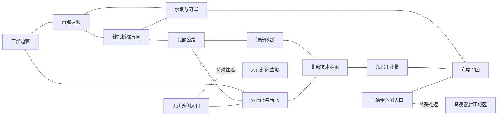

# 派系设计总案

版本：整合初设 0.5（2026-10-31）。本案统一维护文化方向、具体派系创意与组织候选池，替代文化概念卡、创意初步设计、势力与组织候选总表三份并行稿。

依据：[项目概念设计](../../项目概念设计.md)、[战锤设计对比参考表](../原版参考/战锤设计对比参考表.md)。用户明确的方向为约束；原创人物、开局、单位、效果仍是助手候选，不构成首版承诺或技术验证结论。

## 一、文化结构与设计约束

所有可玩文化应有经营、招募、作战、补员、成长和扩张的完整循环。同文化共享兵表、建筑、科技和人物主体，派系以开局、特性及传奇人物区分；一个知名角色或独特模型不足以证明需要新文化。

不整套复制某个战锤种族，先选具体原型，再决定换皮内容。普通 AI 同样需要可用军队和合理开局；允许强弱不对称，避免同时拥有最便宜、最精锐、最全面兵表。

| 标识 | 候选体系 | 主要体验 | 组织建议 |
| --- | --- | --- | --- |
| C01 | NCR | 组织化经营与多兵种火力协同 | 优先作为独立文化；可容纳多个指挥集团 |
| C02 | 凯撒军团 | 突击、兵力接续与征服扩张 | 优先作为独立文化；区分分支派系与最高权威 |
| C03 | 维加斯 | 豪斯经济密谋；好好先生机械智能 | 同文化两派，地方低级兵与事务官共享 |
| C04 | 兄弟会 | 隐蔽堡垒、保守经营与防御 | AI 低扩张、防御优势；精锐容量保留 |
| C05 | 大可汗 | 机动火力、伏击与机会战争 | 保留独立文化候选，先评估兵表与经营完整度 |
| C06 | 锡安部落 | 地形利用、步兵作战与部落发展 | 先比较共享体系的可行性，不默认完全合并 |
| C07 | 大山科技组织 | 实验部队、机器与高技术火力 | 独立文化候选，资产适配风险较高 |
| C08 | 超级变种人 | 大型步兵、Nightkin、巨型与重火力 | 确定与尸鬼分开 |
| C09 | 英克雷 | 毁城收益、技术资料与空中投送 | 激进毁灭倾向；开局与首版范围未定 |
| C10 | 尸鬼 | 消耗恢复、科学家与火箭分支 | 与超级变种人分开，不再讨论合并 |
| G01 | 其他地方组织 | 城市、帮派、雇佣与地方冲突 | 分类池，暂不视作一个统一文化 |
| G02 | 幽灵人与标记人等 | 特定地区的独特军队与身份 | 分别评估，不因来自 DLC 而合并 |

## 二、统一地图与已展开方案

以下使用架空关系与位置，不作为原作政治、年代或精确地理说明；地图采用用户已确认的架空拼接方式，以新维加斯及四个地区为骨架向外扩展；具体边界与连接继续设计。仅考虑单人战役。

### 2.1 本轮设计目标与状态

本轮开始具体功能设计，先给出战区、连接和势力开局的第一版。架空拼接、单人、大地图多势力，以及大山／马德雷的地形隔离与特殊入口，是用户已确认方向；下列分区、连接、起点和奖励组合为助手初设，可继续修改。不是完整聚落清单、精确坐标或已可运行地图。

采用“莫哈维战争尚未决出胜负，各指挥集团已独立行动”的架空格局。NCR 与军团各自存在多个指挥中心，中央权威不直接吞并全部开局。全系列组织可以迁入相邻扩展战区，不以现实北美距离拉长行军。

### 2.2 战区划分与功能

R编号表示规划区，不是一个省份或一个聚落。一个规划区后续可包含多个省份与地方派系，数量由路线、密度和制作条件决定。

| 编号 | 规划区 | 地图作用与地形方向 | 势力布置候选 |
| --- | --- | --- | --- |
| R01 | 西部边疆与共和国门户 | NCR纵深、山口与多条交通线；避免一个入口被堵后全区失去交互 | 汉隆集团、NCR地方守备、大可汗西部据点、掠夺者 |
| R02 | 南部交通走廊 | NCR进军维加斯和前线的通路，地方城镇形成支线战争 | 摩尔集团后方、炸药帮、地方民兵和商贸城镇 |
| R03 | 维加斯都市圈 | 财富与外交中心；城区及外围分属不同城镇，避免豪斯与好好先生占同一聚落 | 豪斯、好好先生、许集团、赌场家族与国王帮；身份是否独立按后续聚落划分择定 |
| R04 | 水坝与河岸前线 | 多渡口、多方向进攻；水坝重要，但不是整条战线唯一过河口 | NCR前线、拉尼乌斯前锋、地方守备 |
| R05 | 东岸军团疆域 | 军团纵深与侧翼出发地；前线集团不会开局挤在同一点 | 拉尼乌斯主据点、武尔佩斯、瓦罗、普通军团与附属部落 |
| R06 | 北部公路与荒野 | 连接都市、锡安及外缘，提供较开放的地方战争 | 大可汗、塔比莎、雅各布斯镇、Boomers、掠夺者 |
| R07 | 锡安峡谷群 | 山地支路与部落争夺，通向主地图和外缘，不作为封闭剧情区 | 白腿、死马、悲伤部落；格雷厄姆在后两者或联合集团中择一归位 |
| R08 | 分水岭与西北废土 | 军事遗产与危险通路，连接西部和北方，形成另一条战线 | 标记人、尤利西斯身份候选、主教／统一教外围据点 |
| R09 | 北部技术走廊 | 科技设施、坚固据点与扩展空间，承接高技术派系冲突 | 英克雷复归集团、兄弟会分部、技术设施守军 |
| R10 | 东北聚落与工业带 | 跨系列势力进入统一地图的主要空间；工业、城镇和荒野交错 | 学院、义勇兵、枪手等；铁路组织作人物／任务内容，暂不分配征服国家开局 |
| R11 | 大山封闭盆地 | 不可跨越地形围合；仅特殊入口连接主地图；内部有真实城镇与设施 | 智脑联合体、实验集团或设施守军，具体拆分待兵表细化 |
| R12 | 马德雷封闭城区 | 不可跨越地形围合；仅特殊入口连接主地图；外围城区与赌场构成内部目标 | 马德雷地方势力、幽灵人及迪恩人物候选；不代表全部尸鬼都被限制在此 |

尸鬼的科学家／火箭分支仍可在开放地图布局，初设放在R03—R06之间的研究设施带；塞拉斯等原创政权另择位置。兄弟会主堡垒位于R01／R03西缘山地，分部才放R09。智慧死亡爪集团暂保留R06—R07荒野候选，不为安置一个领主新建独立大区。上述地点均为Mod架空安排，不声称符合原作地理。

### 2.3 地区连接草图

实线表示普通陆路的规划连接，虚线表示唯一类型的特殊出入连接；不表示地图坐标、道路数量或回合距离。主地图形成数个相连环路，大山和马德雷则是各自独立的封闭区域。图中入口外侧应是可接近、可争夺的实际陆地区域。

大山入口优先放在分水岭侧，使西部、北部与技术派系都有争夺机会；马德雷入口优先放在军团东岸外缘，使东岸有水坝之外的进攻目标。入口属于哪一个具体地区、是否另设守备聚落，下一步随省份划分决定，不自动添加一套入口建筑链。

### 2.4 大山与马德雷的封闭区域功能初设

**已确认边界：**依然是同一战役里的实际领土。地形不可翻越，出入必须通过类似奸奇传送门的特殊交互；当地势力没有对外扩张倾向，但对玩家有明确征服价值。不是单次领奖副本，也不恢复DLC专属剧情流程。此前“大山普通向外扩张、马德雷向邻区推进”的方案撤回。

以下为助手提出的首轮规则：

| 项目 | 初设规则 | 状态／限制 |
| --- | --- | --- |
| 连接 | 每个封闭区域先设计一对固定、双向入口 | 原型选型待查；不设置全图任意传送网络 |
| 使用者 | 正常军队可申请进入与退出，不仅限派系领袖；独立事务官也应有适用的出入方式 | 能否复用同一路线待核，不从原版某种传送的限制直接推定 |
| 开放方式 | 默认不要求剧情钥匙、原作任务、周期开放或一次性资格 | 费用、行动力与是否耗时待原型选型后设计，不新增独立旅行资源 |
| 落点 | 内外两侧保留到达空间；到达后通过正常移动、交战与占领推进 | 不直接传送进入敌方驻军；落点占用、敌军堵口与退路须明确处理 |
| 防守 | 当地AI以保卫本区、经营与应对入侵为主，不主动向外开疆 | 不等于完全停滞、无法反击或无条件放任玩家通过 |
| 玩家占领 | 使用正常占领与地区经营，保留对应地标价值；部队可经入口往返 | 不因征服后永久关闭入口；异地招募与补员按已选文化规则处理 |
| 边界完整 | 地道／特殊姿态、英克雷投送等不得绕过围合地形直达内部 | 战斗飞行单位不等于战役可翻山；跨界特例不得由通用技能意外产生 |
| 不同开局 | 若这些势力后续开放可玩，玩家仍可使用入口对外行动 | 无扩张倾向是当地AI定位，不强制玩家只能困守 |
| 外部AI | 不预设所有AI都能熟练使用入口并组织远征 | 先明确具体原型可用性；不能以玩家可用推断AI可用 |

**攻占价值初设：**优先用已有地标、经济、科技与招募规则表达；普通占领者和特定文化的奖励区分，避免只能由某一派系占领才有意义。

| 区域 | 普遍有意义的价值候选 | 对口文化的附加价值候选 | 内部战争目标 |
| --- | --- | --- | --- |
| 大山 | 高价值科研地标、研究速度或设施收入；具体取少量效果 | 对科技、机器人文化提供适合的研究／招募条件；仍需本文化前提，不免费赠送整套大山兵表 | 夺取外围设施建立立足点，再争夺研究中枢；内部规模不锁定 |
| 马德雷 | 赌场财富、独特建筑及装备／任务奖励候选；占领后有持续经营收益 | 尸鬼或适合背景的文化可获得有限特殊单位／设施效果 | 先控制城区，再攻赌场核心；不复刻炸弹项圈与原作闯关流程 |

奖励强度、守军与建设成本沿正常征服玩法统筹，不使用“征服封闭区后立即无敌”的奖励。此处的目标价值不改变封闭避难所事件的纯随机与不缩放原则；两者是不同内容。

### 2.5 主次战争与开局安排

| 战线 | 主要参与者 | 开局要形成的选择 | 避免的问题 |
| --- | --- | --- | --- |
| 河岸主战线 | 摩尔、拉尼乌斯、各自地方集团 | 集中突破水坝，或争夺其他渡口迂回 | 一个据点锁死全地图东西交互 |
| 都市争夺线 | 豪斯、好好先生、许、赌场地方势力 | 控制外围、争取关系或夺取城市财富 | 三个领袖争同一个开局聚落、豪斯中立等于无法交战 |
| 西部交通线 | 汉隆、大可汗、地方武装 | 清理交通线、北上介入、支援主战线 | 同文化NCR被安排成必须内战才能发展 |
| 北部部落与荒野线 | 白腿、格雷厄姆相关集团、变种人地方政权 | 统一近邻、利用峡谷、向公路与技术走廊发展 | 单一入口造成所有部落只能原地等待 |
| 技术走廊战争 | 英克雷、兄弟会分部、学院、地方军队 | 据点经营、投送打击、选择占领或毁城 | 同类精锐派系只换名字、毁城后技术资料断供 |
| 西北统一教战线 | 主教、标记人与周边势力 | 主教整合外围力量，其他势力阻止或绕开强敌 | 主教自动被改成不可玩的末日刷兵事件 |
| 封闭地区征服 | 入口周边势力、玩家远征军、当地守军 | 投入远征争取独特领土，或先应对主战场压力 | 地区被动等于必须全球进攻、征服后变成无收益空地 |

普通AI按守备、扩张、劫掠或缓冲职责布置，复用既有兵表。每个主要开局应有邻近冲突对象，以及至少一种扩张以外的阶段选择，例如支援友军、争取关键设施或整顿后方。不要把所有传奇人物同时塞在维加斯周边。

### 2.6 本批设计交付与后续顺序

本批已给出12个规划区、普通陆路与两个封闭区的连接、主要战争方向及重点派系位置候选。未锁定全图省份数、城镇数、可玩数量与最终坐标，也未自动把所有组织升级为独立文化。

下一批按此草图逐区细化省份／聚落功能和起始势力，再为主要文化选择兵表原型与经营机制。地图产物必须后续验证不可通行地形、入口交互、往返与AI；入口路线不成立时先报告问题并调整技术选型，不擅自改回普通陆路或独立副本。

### 四、NCR：同一共和国的三种战争

#### 派系一：莫哈维战区——卡桑德拉·摩尔

- **开局想象：**拥有相对稳定的军事据点，但直面军团前线。玩家能较快组建正规军，战争压力也最直接。
- **派系特性候选：**偏军事建筑、驻军与常规军招募；依靠现成效果表达。
- **领主军队倾向：**正规步枪兵、重武器和炮兵，建立可持续推进的阵线。
- **短期目标：**守住一个关键渡口或前线据点，再夺取对岸支点。
- **长期目标：**赢得主要战争并取得 NCR 各集团的政治主导权。

#### 派系二：边境游骑兵——汉隆

- **开局想象：**偏远前沿、城少地广，面临地方武装与侧翼威胁。
- **派系特性候选：**游骑兵招募与侦察、伏击相关优势，经营收益不额外强化。
- **领主军队倾向：**精锐射手、侦察部队、少量郊狼或战犬；擅长挑选交战位置。
- **短期目标：**击败一支威胁交通线的敌军，建立第二个安全据点。
- **长期目标：**控制西部通路与关键前线，成为共和国不可忽视的军事力量。

#### 派系三：麦卡伦指挥部——许

- **开局想象：**靠近维加斯的复杂邻接区，既能扩张，也需要处理城市势力。
- **派系特性候选：**地方经营、外交及步兵补充方向；不再新增特殊资源。
- **领主军队倾向：**常规步兵、近程突击和预备队能力，偏稳健混合编成。
- **目标：**保障城市外围与交通，再选择支持前线集团或独立争取政治优势。

#### NCR 政治的初设

使用一套选定原型的影响力／支持表达。正常阶段竞争指挥权和关系，不鼓励常态互相攻城。公开战争发生时，按已确认原则判定支持较少者为叛军，触发共同敌对。

此处只确定政治体验，不增加自制议会、选举和中央政府模拟。支持指标、支付方式、叛乱判定和 AI 协调待原型核验后设计，不能把当前资源余额直接当成政治合法性。

### 五、凯撒军团：铁砧、暗刃与兽群

| 派系／领主候选 | 开局与配军 | 派系特色与目标 |
| --- | --- | --- |
| 东岸征服军——拉尼乌斯 | 正面前线；重装近战、突击队、有限火力 | 招募与战后收益偏进攻；目标是建立跨河占领区 |
| 渗透军团——武尔佩斯 | 偏离主战线的边缘据点；轻装、散兵、潜行部队 | 伏击与事务官方向；目标是切入敌后并夺取交通节点 |
| 血爪军团——驯兽师瓦罗【原创】 | 边境荒野；普通军团兵、战兽和少量高级生物 | 部分生物招募权限及所率军队加成；目标是建立兽群军团并参加西征 |

瓦罗的特色先用少量专属招募与技能完成，不默认制作完整捕兽池。普通军团仍以军团兵为主体，不能因为有驯兽师就全部变成怪兽文化。

凯撒本人暂放在普通开局之外：作为最高权威和特殊战争力量保留。可采用现成仪式式的征战动员或祝福表达；登场、整合与可玩方式后定，不直接触发全地图共同讨伐凯撒。

### 六、维加斯：豪斯与好好先生

#### 幸运38——豪斯先生

发挥中立地位、经济优势和间谍密谋。中立是周旋空间，不是永久免战。用经济、人物、事务官和选定战略干预原型形成优势，保留机器人高级部队，但不以机械智能成长作为主轴。

- 地方枪手、警卫、雇佣兵等低级部队支撑常规作战。
- 赌场线人、掮客等特殊事务官承担侦察、外交或适用阴谋行动；具体权限按原型选择。
- 豪斯的代理机体表现仍为助手候选，不作为用户已确认的人物形态。
- 开局与目标建议：财富集中、邻接多方，先争取生存空间和影响力，再控制维加斯及关键设施。

#### 独立维加斯——好好先生

取代自治同盟与原创“调停人”开局，以机器人军队和机械智能成长为核心。

- 特殊资源暂称“智能化数据”，名称、获得和消耗未定。
- 升级候选分为瞄准、装甲、协同或支援等主题；优先参考现成单位升级／强化与解锁，不开发完整机械 AI 或自由拼装系统。
- 地方低级兵与特殊事务官来自两派共享池，但后期军队倾向机器人主力。
- 开局与目标建议：从有限机器人编队起步，逐步恢复升级能力，建立独立机械秩序。

#### 地方自治力量的归位

自治同盟不再作为独立派系。其社区卫队、地方枪手、雇佣兵与联络人等素材转为两派共有的基层部队和特殊事务官，不再保留原创调停人领主。

豪斯强在财政、关系和密谋，好好先生强在机器人及智能升级；共享兵表不等于共享全部招牌机制。

### 七、兄弟会与英克雷：堡垒防御与空中毁灭

#### 兄弟会

以隐蔽堡垒为核心保守经营，参考鼠人聚落伪装废墟。低扩张意愿针对 AI；玩家仍可自行选择远征。

- 保留辅助枪兵、常规骑士与受容量限制的动力装甲精锐。
- 防御优势参考驻军、防守相关效果与适合场景，不强制改成传统高墙。
- 麦克纳马拉偏经营与守备，哈丁作为较主动的支部领主候选，但不改变全文化防守基调。
- 城镇伪装、侦察发现、AI 扩张和防御加成分别核对，不能假设废墟外观自动阻止 AI 攻击。
- 维罗妮卡本轮先作为邮差随从，独立英雄表现暂缓，避免同名无关联重复。

#### 英克雷

主动进攻、毁灭城镇取得高收益，参考用户提出的木精灵方向；保留技术资料解锁高级兵种和容量。

- 技术资料来源候选加入任务与适合的毁城／战果奖励，避免必须占领设施才能成长的冲突。
- 关键节点可以保留，其他目标可选择摧毁；不是强制所有城镇都夷平。
- 战役投送参考现成特殊移动，以飞艇或空运解释；战斗层使用空投、扫射、轰炸等支援或有限飞行单位。
- 不因“飞艇”一词自动新增自由移动基地、海军或航线模拟。
- 海斯上校仍为原创领主候选，具体开局、部队和支援能力未定。

兄弟会重点在隐蔽堡垒的长期积累与防守，英克雷重点在投送、打击和毁城后的收益；技术资料和容量服务于这些路线，不让两者退化为相同精锐兵表。

### 八、大可汗与锡安：简单机制也能有完整战役

#### 大可汗：红岩汗庭——老爹可汗

以散兵、步枪、骑乘射击和战车式机动单位为主要候选；药剂用有限主动能力表达。

开局处于山地与交通线之间，选择劫掠强敌、吞并弱邻或参与大国战争。军队更适合绕侧、伏击和追击，正面强攻有代价。

不用新增药品经营或独立商队机制。人物、机动兵表、开局位置和常规战役特性先承担差异。瑞吉斯等人物是否成为其他派系领主，留到扩展名单时再定。

#### 锡安部落：白腿征服者与峡谷同盟

- **白腿征服者——苏盐之伤：**近战、突击和投射混合，偏进攻与战后收益，目标是统一北部地区。
- **峡谷同盟——约书亚·格雷厄姆：**枪械与近战混编，偏部署、守备和步兵协同，目标是守住家园后介入主地图。
- **丹尼尔：**可作为支援型传奇英雄候选，无需为了人物知名度再拆一个完整派系。

两派是否共享一个文化取决于基础兵表共性，不为了“都来自锡安”强行合并。没有锡安独立生存系统、独立资源或特殊入口。

### 九、大山与变异群体：三种不同的怪异战争

#### 大山研究集团

- **智脑联合体——克莱因：**机器人、能量武器小队、少量实验体；人物通过现成支援平台或机械形态表现。
- **禁区实验团——“伊芙博士”【原创】：**实验体、毒气、控制支援与少量机器。与智脑共享基础经营，但改变军队权限和技能倾向。

以现成特殊武器、区域伤害、减益和召唤类能力提供玩法，不再叠加实验配方经营系统。两派的科技树与建筑主体可以共享。

#### 超级变种人集团

与尸鬼明确分开。基本手感参考绿皮／食人魔的大型、强攻与粗重火力；并非整套复制其经济或政治。

- **普通主体：**近战超级变种人与普通重武器部队。
- **隐蔽分支：**Nightkin 夜行变种人，使用现成潜行、隐蔽或有限隐身能力；这里不是犬形夜行潜猎者。
- **巨型分支：**巨人职责的巨型变种人，作为少量高阶单体。
- **火力分支：**参考风暴鼠魔等原型的重装火力变种人，兼顾强壮体型与持续火力。
- 塔比莎、灰脊等仍为前版人物候选；灰脊是否归入该文化后定，不因死亡爪首领而稀释超级变种人主体。
- 新增主教／The Master 为该方向领袖候选，使用统一教身份；架空共存，不要求复刻原作年代。具体领主战斗原型后定。

#### 尸鬼集团

文化方向参考吸血鬼／僵尸势力：普通尸鬼、狂尸鬼、特殊发光单位及适合的再生／复活。理性尸鬼仍可承担射击、研究和指挥职责，不全部按无脑僵尸处理。

- **科学家与火箭：**加入 REPCONN／“Come Fly With Me”的背景主题。
- **新增派系候选：**“伟大旅程”——杰森·布莱特；科学家事务官提供技术／炮兵支援，火箭可分别作为研究解锁、有限炮击或稀缺火箭炮兵候选。
- **技术角色候选：**克里斯·哈弗萨姆作为合作工程人员；他在原作中是人类，不因服务尸鬼派系改称尸鬼科学家。
- 原作火箭计划转译为军事用途属于本 Mod 架空设计，不声称原作就是火箭军队。
- 背景核对：[Come Fly With Me](https://fallout.fandom.com/wiki/Come_Fly_With_Me)、[杰森·布莱特](https://fallout.fandom.com/wiki/Jason_Bright)。这些资料用于角色与火箭计划的素材参考，不证明本项目兵种或机制实现。
- 塞拉斯、迪恩·多米诺两条旧候选保留，未决定全部制作。科学家／火箭线属于尸鬼文化的一条特色分支，不要求所有尸鬼领主拥有同样能力。

邮差可作为跨派系传奇事务官加入相关军队，详细见[邮差设计](./邮差传奇事务官设计.md)，不归为尸鬼或变种人专属人物。

### 十、代表兵种：用少量例子检验原型路线

| 单位候选 | 战术职责 | 战锤参考起点 | 设计意图 |
| --- | --- | --- | --- |
| NCR 制式步枪队 | 常规直射 | 帝国火枪手类 | 稳定的基本火力，不承担所有专业职责 |
| NCR 反器材游骑兵 | 专业远程 | 优先霍克长管步枪手；抬枪保留职责参考 | 同为人形可减少骨架差异，仍待外观适配 |
| NCR 郊狼队 | 追击与绕侧 | 战兽／战獒类 | 为正规军提供低成本机动工具 |
| 军团重刃队 | 近战突破 | 现成重型输出步兵 | 进入接敌后提供主要杀伤 |
| 瓦罗驯化死亡爪 | 稀缺单体突破 | 用户提出的大魔类候选 | 体现驯兽领主差异，普通军团不普及 |
| 兄弟会辅助枪兵 | 守备与普通火力 | 普通枪兵 | 保持精锐之外的可用兵力 |
| 兄弟会重装骑士 | 重甲专业部队 | 适合的重甲步兵原型 | 用容量控制强力单位普及 |
| 维加斯重型保安机 | 机器火力核心 | 适合机械单体／平台 | 接受原型行为后再决定具体外形 |
| 大山毒气武器组 | 区域减益与伤害 | 喷射／区域能力原型 | 通过已有能力补足实验军队手段 |
| 超级变种人重击队 | 大型步兵 | 食人魔或其他大型步兵类 | 多模型力量与被射击风险并存 |
| Nightkin 夜行变种人 | 潜行突击 | 适合隐蔽／隐身的近战原型 | 为大型部队提供侧翼与潜入方向 |
| 巨型变种人 | 单体突破 | 巨人类 | 有别于常规多模型变种人 |
| 重装火力变种人 | 大型持续火力 | 风暴鼠魔类 | 保留原型射击与近战行为再换皮 |
| REPCONN 火箭组 | 稀缺炮兵／支援 | 火箭炮兵或轰击能力 | 两种路线择合适原型，不默认双份制作 |
| 狂尸鬼群 | 近战消耗 | 群体近战步兵 | 数量与特殊状态形成特色 |
| 变异蝙蝠群 | 空中骚扰 | 蝙蝠／飞兽类 | 给部分生物军队提供飞行工具 |

这里只列代表例子，不是完整兵表，也不认定同职责只能使用同一个原型。模型、绑定、武器与动作仍需对应样本核验。

### 十一、人物加点、科技与建筑：先给内容方向

#### 人物类型

普通领主从军官、近战统帅、技术指挥、驯兽首领等定位中选择；事务官从护卫、狙击／潜行、医疗、工程和技术支援等定位中选择。并非每文化都拥有全部类型。

| 人物例子 | 蓝线／战役方向 | 红线／军队方向 | 个人及独特方向 |
| --- | --- | --- | --- |
| 汉隆 | 侦察、伏击与野外行动 | 游骑兵和散兵 | 射击、部署与有限支援 |
| 拉尼乌斯 | 征战与战后收益 | 重装和突击步兵 | 近战突破与威慑 |
| 瓦罗 | 生物招募与维持 | 战兽和少量怪兽 | 驯兽增益、本人近战 |
| 豪斯候选原型 | 适用的战役效果 | 地方部队及高级机器人 | 经济、间谍与密谋方向 |
| 好好先生 | 机器人发展方向 | 机器人主力 | 智能化升级主题 |
| 海斯上校 | 精锐军队发展 | 指定高级步兵 | 有限火力支援与射击 |

上表是内容主题，不表示所有效果都必须通过技能实现；派系特性与人物技能要避免重复。英雄使用适合自己的战斗、行动或嵌入线，不复制完整领主红线。

#### 科技主题候选

- NCR：常规军训练、游骑兵专业化、建设与军队维持。
- 军团：兵种训练、突击协同、征战和选定特殊单位。
- 维加斯：共享常规基础；豪斯偏经济与行动，好好先生偏机器人智能升级，避免重复收费。
- 兄弟会：堡垒、防御、精锐装备、辅助部队与容量。
- 英克雷：毁城战争、空中投送与精锐；技术资料承担的解锁不在科技中重复设门槛。
- 大山：武器小队、实验体与相应战场能力。
- 部落与大可汗：训练、机动、地区行动与常规经营。
- 超级变种人：常规大型兵、夜行变种人、巨型与重火力分支。
- 尸鬼：消耗与恢复、辐射适应、科学家和火箭主题。

#### 建筑方向

各文化沿用主聚落、收入、发展、治理、普通军事、专业军事、防御与地标等结构。主要改变名字、解锁对象及少量效果；不为每文化发明全新的建筑分类。

### 十二、城市战、能力与辐射的共同表达

城市战先设计能用现成规则完成的街道、建筑遮挡、路障、火力点和目标。破障只围绕选定的可破坏节点展开；动态大楼倒塌、攻城塔改坦克和战前强制野战仍是待查候选，不作为这版体验成立的必要条件。

战斗能力用具体身份表达：军官下达预备队指令；医疗人员提供治疗；技术人员提供有限防护；大山使用毒气和实验火力；具备条件的派系使用炮击或空中支援。每种文化只取合适部分，不配齐全部技能。

辐射先参考一条地区影响规则：普通军队有代价，选定群体耐受或受益。受益优先选择一种容易理解的主要效果，不同时赠送大幅治疗、伤害、免疫和经济优势。混编及地区效果的技术边界沿用对比表记录。

### 十三、商路与特殊地点的少量内容样例

避难所按用户修改采用[三类初设](./避难所玩法初设.md)：完整开放型是特殊城镇，具有专属地面序列、正常派系建筑和参考矮人深隧的地下建设；封闭型只在已有城镇触发随机发现，忽略无事、开启可获益或触发灾难；残缺遗址型是指定城镇的特殊建筑。上一版统一自治／接管等处置流程已撤回。

自治同盟已撤销，原商队归属提案随之撤回。商队仍保留为可选原版机制，本轮先选商贸城邦／商队公司作为调查对象，详见第九节；不自动转给好好先生，也不影响豪斯经济与密谋的核心定位。

| 原版结构 | 换皮内容候选 | 初设体验 |
| --- | --- | --- |
| 固定地标 | 胡佛水坝、太阳神一号、赌场、研究设施 | 争夺地点并获得对应收益或招募条件 |
| 地点事件 | 城镇地下发现封闭避难所、废弃军事设施 | 忽略无事；开启避难所后可获得奖励、强敌、减益乃至城镇爆炸成废墟 |
| 任务战 | 武器库守卫、实验场失控军队 | 一场明确目标的战斗与奖励 |
| 商队遭遇 | 临检、地方劫掠者、雇佣护卫 | 按原版商队事件方式做选择或战斗 |
| 特殊地区敌军 | 标记人集团、野生生物军队 | 与主战役相同规则的敌军或地方势力 |

不在本版引入随机生成建筑或多层地下城。分水岭标记人、炸药帮、Boomers 等先保留为普通地方派系候选，原作人物是否统领和是否开放可玩后定。

## 三、势力、组织与人物候选池

标识 F01—F38、L01—L21 用于内容追踪，共59条内容记录，包含集团、人物、组织、模板池和已转为素材储备的条目，并非59个已确定独立派系。来源列保留用户点名、已有讨论与助手扩充的区别。

### 二、已有主体与分支

| 标识 | 名称或方向 | 来源 | 暂定表现 | 共享与区别 |
| --- | --- | --- | --- | --- |
| F01 | NCR 莫哈维战区／摩尔 | 已有讨论 | 可玩候选 | 共享 NCR，正规军与前线 |
| F02 | NCR 边境游骑兵／汉隆 | 已有讨论 | 可玩候选 | 同文化，游骑兵与侦察 |
| F03 | NCR 麦卡伦集团／许 | 已有讨论 | 可玩候选 | 同文化，地方经营与混合军队 |
| F04 | NCR 地方守备与边疆指挥部 | 助手扩充 | 普通 AI 池 | 共享兵表，用开局与少量特性区分 |
| F05 | 拉尼乌斯征服军 | 已有讨论 | 可玩候选 | 共享军团，正面突击 |
| F06 | 武尔佩斯渗透集团 | 已有讨论 | 可玩候选 | 同文化，轻装与隐蔽 |
| F07 | 瓦罗驯兽军团【原创】 | 已有讨论 | 可玩候选 | 同文化，有限生物招募 |
| F08 | 军团边疆部落与地方统帅 | 助手扩充 | 普通 AI 池 | 同文化不同军团，不逐家造系统 |
| F09 | 凯撒本人及直属力量 | 用户点名 | 特殊地位候选 | 不作为普通开局，出现方式待定 |
| F10 | 豪斯／幸运38 | 用户点名 | 可玩候选 | 维加斯文化，经济、中立与密谋 |
| F11 | 好好先生／独立维加斯 | 用户点名 | 可玩候选 | 同文化，智能化与机器人 |
| F12 | 莫哈维兄弟会／麦克纳马拉 | 已有讨论 | 可玩候选 | 隐蔽堡垒与保守经营 |
| F13 | 哈丁及其他兄弟会支部 | 已有讨论 | 可玩或 AI 候选 | 共享兄弟会主体，差异不必大到另建文化 |
| F14 | 英克雷复归集团 | 用户点名 | 可玩候选 | 技术资料、毁城、空中投送 |
| F15 | 英克雷前哨／远征分队 | 助手扩充 | 普通 AI 池 | 共享核心，仅改编成和开局 |
| F16 | 大可汗 | 已有讨论 | 可玩候选 | 机动兵表；是否独立文化待比较 |
| F17 | 白腿部落 | 已有讨论 | 可玩候选 | 部落征服路线 |
| F18 | 死马部落 | 已有讨论 | AI 或可玩候选 | 保留独立身份，兵表共享程度待定 |
| F19 | 悲伤部落 | 已有讨论 | AI 或可玩候选 | 同上，不必独立核心机制 |
| F20 | 格雷厄姆的峡谷同盟 | 已有讨论 | 领主／联盟方向 | 本轮先归F18死马集团，不另布重复的峡谷同盟国家；属于助手方案 |
| F21 | 智脑联合体／克莱因 | 已有讨论 | 可玩候选 | 大山科技体系 |
| F22 | 禁区实验集团／伊芙博士【原创】 | 已有讨论 | 可玩或 AI 候选 | 与大山共享基础，偏实验体 |
| F23 | 超级变种人军阀／塔比莎等 | 已有讨论 | 可玩候选 | 大型、Nightkin、巨型与重火力 |
| F24 | 灰脊智慧死亡爪集团【原创】 | 用户方向＋已有初设 | 可玩或 AI 候选 | 文化归属后定，不因此新造繁殖系统 |
| F25 | 主教／The Master 的统一教 | 用户点名 | 超级变种人领主候选 | 允许跨年代；不是新里诺的 Bishop 家族 |
| F26 | 尸鬼余烬议会／塞拉斯【原创】 | 已有讨论 | 可玩候选 | 独立尸鬼文化 |
| F27 | 杰森·布莱特／伟大旅程 | 已有讨论 | 可玩候选 | 科学家与火箭分支 |
| F28 | 马德雷遗民／迪恩·多米诺 | 已有讨论 | 可玩或 AI 候选 | 幽灵人与地区军队，架空改编 |

### 三、用户新增或强调的组织

| 标识 | 对象 | 优先表现建议 | 原型与内容成本方向 |
| --- | --- | --- | --- |
| F29 | 中国背景的战前潜伏／军事残部 | 世界观素材储备，不作为派系 | 撤销地方 AI／可玩候选身份，不设计专属兵表、科技与开局；见第五节 |
| F30 | 中国背景的科技或侨民集团 | 世界观素材储备，不作为派系 | 撤销独立组织／AI 派系候选身份；区分战后社群与战前军方，见第五节 |
| F31 | 原子神教 | 先确保组织、人物、事件、特殊地点与地标存在 | 暂不强造完整兵表；适合时可有共享兵表的小型据点派系 |
| F32 | 大炮族／Boomers | 有领土的特殊 AI，保留可玩可能 | 内利斯起点候选，普通守备配稀缺炮兵／支援；不强造另一套空军 |
| F33 | 天启追随者 | 支援组织、技术／医疗人物、地方关系及任务 | 不必承担征服国家身份，也不沦为默认敌对经验包 |
| F34 | 尤利西斯 | 传奇人物，或分水岭地方派系领袖 | 两种身份择定；不自动一边当可招英雄、一边统领敌军 |
| F35 | 义勇兵 | 多个民兵 AI／潜在可玩集团 | 基础人类兵表共享，以守备、组织者和开局区分，不先建立复杂新文化 |
| F36 | 铁路组织 | 隐蔽组织、特殊事务官和任务网络；保留小型派系候选 | 先用已有隐蔽、人物与事件结构，不新造全图谍报模拟 |
| F37 | 学院 | 可玩／主要 AI 候选 | 合成人与技术支援可从现成步兵、机械原型选型；是否独立文化取决于实际差异 |
| F38 | 各类普通掠夺者 | 多个独立 AI | 参考诺斯卡式多个地方派系布置，复用少数基础兵表与模板 |

### 四、地方派系与掠夺者扩充池

以下优先作为地图上的敌友、缓冲区与早期战争对象，不默认每个都有传奇领主和独立机制。

| 标识 | 名称或方向 | 来源 | 表现建议 |
| --- | --- | --- | --- |
| L01 | 瘾君子帮／Fiends | 已有讨论 | 多个相关 AI 据点；3号避难所可作核心 |
| L02 | 炸药帮 | 已有讨论 | 地方 AI，可有监狱与避难所分支候选 |
| L03 | 蝰蛇帮／Vipers | 助手扩充 | 共享掠夺者模板的地方 AI |
| L04 | 胡狼帮／Jackals | 助手扩充 | 同上，用编成与位置体现差异 |
| L05 | 大汗分支或脱离集团 | 助手扩充 | 共享大可汗主体，具体是否独立由开局图决定 |
| L06 | 国王帮 | 已有讨论 | 地方政治组织或小型 AI，保留特色人物 |
| L07 | Omertas | 已有讨论 | 赌场家族，地方组织／派系二选一 |
| L08 | Chairmen | 已有讨论 | 同上，优先复用维加斯地方部队 |
| L09 | White Glove Society | 已有讨论 | 同上，不为家族独立开发完整文化 |
| L10 | 标记人集团 | 已有讨论 | 分水岭一个或多个 AI；尤利西斯归属另定 |
| L11 | 雅各布斯镇 | 已有讨论 | 有组织的变种人地方政权，与军阀区别 |
| L12 | 商队公司与商贸城邦 | 助手扩充 | 地方 AI、商队内容或贸易组织，依地图需要选 |
| L13 | 避难所居民政权 | 用户强调＋本轮设计 | 活跃避难所的地方 AI，可交涉、结盟或交战 |
| L14 | 避难所城主题集团 | 助手扩充 | 从跨系列素材取政治与建设主题，不自动添加原作地区 |
| L15 | 枪手／Gunners | 助手扩充 | 雇佣军事集团 AI，普通人形专业兵变体 |
| L16 | 锈魔帮／Rust Devils | 助手扩充 | 掠夺者＋少量机器人；复用已有资产族 |
| L17 | 锻铁帮／Forged | 助手扩充 | 近战与喷火倾向，普通 AI |
| L18 | 门徒帮／Disciples | 助手扩充 | 近战突击倾向，普通 AI |
| L19 | 特工帮／Operators | 助手扩充 | 枪械与利益倾向，普通 AI |
| L20 | 群狼帮／Pack | 助手扩充 | 突击与生物装饰倾向，普通 AI |
| L21 | 地方掠夺营、军阀、山匪与走私团 | 用户方向＋助手扩充 | 原创通用名池，同类兵表，多种开局与敌友关系 |

中文名在正式文本阶段统一；原作名称只提供身份，不等于已照搬其兵表、剧情和地理。扩充池中可删除重复、不适合地图或没有实际作用的候选。

## 四、扩展方法、重叠与下一步

### 五、派系增多的实际设计方法

1. 优先增加同文化不同开局和普通 AI，而非每次增加一套兵表、建筑、科技和资源。
2. 通用 AI 至少有定位：守备、扩张、劫掠、缓冲或贸易。不同模板改军队倾向、初始关系与起点，不必各有专属面板。
3. 允许强弱不对称：小帮派可以弱，但应能形成地理和外交意义，而不是无限刷新经验。
4. 地图先布主战线、支线冲突和地方势力，再决定聚落密度；不靠无意义拉长行军距离扩大面积。
5. 不让每个新名字都获得完整独立资源；原子神教等存在感可由高辨识度的组织内容承担。

### 六、原型与技术待定

学院合成人和新增民兵是否共享现有文化，主教的战斗形态，铁路组织的表现，原子神教事件位置，新增 AI 数量与地图性能，均未核验。

本表先完成内容占位，不宣布全部可玩，也不进入批量资产制作。实际活跃派系数量需与回合等待、AI 行动和地图密度一起评估。

背景核对：[The Master](https://fallout.fandom.com/wiki/Master)、[Unity](https://fallout.fandom.com/wiki/Unity)。其他新增组别目前为身份候选，详细原作内容在具体选型时再核对；不要求其年代共存。

重点比较 NCR 与大可汗的射击体验、军团与部落的突击体验、维加斯与大山的机器人体验、兄弟会与英克雷的精锐体验。差异优先由兵表职责、开局和现成效果承担，不为了区别而添加资源系统。

助手继续完成原型选型、势力关系和地图布局提案，再细化兵表、科技建筑及人物。首版数量不由候选表自动决定。

邮差与避难所分别只在[邮差设计](./邮差传奇事务官设计.md)、[避难所设计](./避难所玩法初设.md)维护详细规则。避难所三类完全独立；封闭型开启后果纯随机，不预警、不保底、不按时期调整收益，也不转成其他两类。

## 五、中国背景素材储备（不作为派系）

用户决定：暂不设计中国背景派系，包括独立文化、可玩派系和普通 AI。按原作中相关集团的现有体量，难以形成所需兵表、科技等基础内容，且与本项目主体文化的交互较难成立。F29、F30保留标识，仅为追踪素材，不保留派系制作资格。

本节是后续准备材料，不是采用方案；不把不同作品中的中方军人、情报人员和华裔后裔合并成一个政治实体。背景中的潜艇只作人物与事件资料，不改变项目不涉及海军的原则。以下是代表性资料索引，尚未逐项在游戏内核对，不声称已穷尽全系列内容。

| 作品／条目 | 特色与内容 | 主要人物与事件 | 资料依据 |
| --- | --- | --- | --- |
| 《辐射2》石族／Shi | 战后旧金山社群，其祖先来自中国潜艇船员；可提供战前技术与战后文化延续的素材 | 石族社群及其潜艇起源；具体人物与研究事件后续补录 | [Shi资料](https://fallout.fandom.com/wiki/Shi) |
| 《辐射3》Mama Dolce’s与中国残部 | 战前掩护设施内存留的尸鬼化军人，兼有秘密行动遗产与漫长滞留主题 | 中国残部队长、食品厂据点与加密终端记录 | [中国残部](https://fallout.fandom.com/wiki/Chinese_remnant_soldier)、[据点](https://fallout.fandom.com/wiki/Mama_Dolce%27s) |
| 《辐射3：望海崖》The Velvet Curtain | 战前谍报、秘密联络、遗留命令与设施自毁资料 | 特工Jiang、Wan Yang；追查情报、寻找潜艇自毁代码的任务 | [任务资料](https://fallout.fandom.com/wiki/The_Velvet_Curtain) |
| 《辐射4》Yangtze-31 | 战前核战争参与者、尸鬼幸存者与返乡愿望，适合作为人物故事素材 | Zao舰长；Here There Be Monsters任务及修复潜艇背景 | [Zao](https://fallout.fandom.com/wiki/Zao)、[Yangtze](https://fallout.fandom.com/wiki/Yangtze) |

下一步待补资料：安克雷奇模拟中的人物与装备、大山相关拘禁设施、《辐射76》相关情报设施与人物。应区分模拟叙事、战前记录和战后实际人物，查明后再登记具体内容；本次不据此编造角色或扩充军队。

后续如发现适合的内容，可再提人物、装备、地点文本或事件方案；目前仅保留准备材料，不提前决定加入方式，不恢复为派系。

## 六、省份、聚落与起始归属工作稿

### 6.1 划分口径

本节承接第二节草图，首次把规划区落实为可逐项修改的地图内容。当前规模草案为24个省份、每省3个聚落，共72个聚落；这是排布用工作样本，不是地图上限、首版规模承诺或已验证容量。位置、比例、道路距离仍需地图源文件落地后确定。每省依次用A、B、C表示三个聚落，例如P01A；A暂作省会。临时地名不声称是原作正式地点。

表内F／L沿用第三节候选编号。`L21-西路`等是同一普通掠夺者模板下不同AI，不把不同后缀误当一个跨地图大国；`F04-西关`等同理。未划给组织的遗址与设施可作为地标附属内容，不为每座遗址另造聚落。所有初始归属为助手方案。

### 6.2 省份与聚落表

| 省份／规划区 | A：省会／初始归属 | B：次级聚落／初始归属 | C：次级聚落／初始归属 | 地图功能与建设主题 |
| --- | --- | --- | --- | --- |
| P01 西关边境／R01 | 游骑兵前进营／F02 | 西关贸易站／F04-西关 | 干谷哨所／L21-西路 | 汉隆的安全起点与首个地方冲突 |
| P02 西部山口／R01 | 红岩据点／F16 | 旧矿镇／L21-矿匪 | 隐蔽山堡／F12 | 大可汗与兄弟会各有起点，不开局强制同省相残 |
| P03 南部干线／R02 | 南线军营／F01 | 公路补给站／F01 | 废旧惩戒所／L02 | 摩尔后方与炸药帮；发展、收入与招募 |
| P04 南缘聚落／R02 | 共同体避难所城／L13 | 民兵村／F35-南民兵 | 干井营地／L21-南匪 | 不同敌友与南侧支路，避免只有一条走廊 |
| P05 赌城核心／R03 | 幸运38街区／F10 | 赌场东街／L07 | 旧会馆／L08 | 都市分区作为架空独立聚落，各家族与豪斯起初不必交战 |
| P06 赌城外围／R03 | 独立机库／F11 | 麦卡伦营区／F03 | 自由街区／L06 | 好好先生与许的独立起点；国王帮作为有领土地方AI初设 |
| P07 西岸防线／R04 | 西岸大坝堡垒／F01 | 河岸补给镇／F04-河防 | 西岸渡口／F04-河防 | NCR前线支点；大坝地标在A，不跨阵营重复建两座大坝 |
| P08 河湾通路／R04 | 东岸桥头／F05 | 浅滩村／F08-河湾 | 南湾渡口／L21-河匪 | 至少另一处过河机会；控制区与道路仍需实图检查 |
| P09 军团东岸／R05 | 征服军营／F05 | 东岸军需镇／F05 | 边疆部落堡／F08-东岸 | 拉尼乌斯的核心与前进方向 |
| P10 东部荒原／R05 | 暗刃营／F06 | 血爪兽栏堡／F07 | 黄沙部落／F08-荒原 | 武尔佩斯与瓦罗分开起点；马德雷外侧入口设在C附近通行地 |
| P11 北路城镇／R06 | 北路集市／L12-北商镇 | 空军基地／F32 | 辐射高台／F23 | 商贸、Boomers与塔比莎三个地方中心 |
| P12 北部荒野／R06 | 雅各布斯聚落／L11 | 火箭研究院／F27 | 野爪领地／F24 | 理性变种人、尸鬼科学家和智慧死亡爪各保留身份 |
| P13 锡安西峡／R07 | 死马山寨／F18 | 峡口守望／F18 | 旧公路村／L21-峡匪 | 格雷厄姆暂归死马集团，避免另建重复峡谷同盟国家 |
| P14 锡安东峡／R07 | 白腿战营／F17 | 悲伤部落寨／F19 | 东峡据点／F17 | 部落战线与向北外通路 |
| P15 分水岭／R08 | 标记人要塞／L10 | 弹坑前哨／L10 | 断路镇／L21-断路匪 | 尤利西斯先作为相关任务人物，不同时建独立领土与可招英雄 |
| P16 西北旧军事带／R08 | 统一教中枢／F25 | 改造营地／F25 | 荒废试验站／L21-试验站匪 | 主教的真实开局势力；大山外侧入口设在C附近，非主教专用 |
| P17 北部航空走廊／R09 | 复归基地／F14 | 旧航空站／F15-北航空站 | 货运设施／L15-北枪手 | 英克雷开局有可经营支点，同时可毁城获取收益 |
| P18 山地技术区／R09 | 山堡分部／F13 | 余烬聚落／F26 | 工业山镇／L15-山枪手 | 哈丁与塞拉斯原创尸鬼政权；不把所有尸鬼塞入马德雷 |
| P19 东北聚落群／R10 | 民兵议事镇／F35-北民兵 | 交易枢纽／L12-东商镇 | 锈机工坊／L16 | 义勇兵共享民兵模板；商贸、掠夺者与机器混编 |
| P20 东北工业区／R10 | 学院设施城／F37 | 合成人前哨／F37 | 熔炉工镇／L17 | 学院先按主要AI设计，保留未来可玩；铁路组织无独立领土 |
| P21 大山外环／R11 | 设施守备区／F21 | 废弃试验区／F22 | 机械维修区／F21 | 内侧入口落在A外围空地，设施之间仍按正常陆路交战 |
| P22 大山中枢／R11 | 智脑中枢／F21 | 生物实验区／F22 | 研究档案馆／F21 | 科研与机械地标；实验集团作为内部竞争者初设 |
| P23 马德雷外城／R12 | 旧街区／F28 | 服务设施区／L21-马德雷守军 | 废墟住宅区／F28 | 内侧入口在A外围；守军模板使用当地幽灵人兵表，非普通人类匪帮 |
| P24 马德雷内城／R12 | 马德雷赌场／F28 | 安保中枢／F28 | 废弃客栈／F28 | 财富核心与特殊守军；迪恩的领袖身份为架空初设 |

P23B使用L21编号仅为普通AI模板管理，不把马德雷守军设定成原作中的某个新掠夺者组织。白手套协会L09暂作为P05地方建筑／事件组织，不同时占有旧会馆。F20峡谷同盟名称不再另放一个国家，格雷厄姆归F18是当前助手执行选择；可在后续反馈中修改。

完整开放避难所样板采用P04A共同体避难所城，归L13；遗址型样板放在P19B交易枢纽。具体功能、建筑与技术边界只在[避难所设计](./避难所玩法初设.md)维护。封闭型仍只作随机事件，不预留地图聚落。上述位置是设计选择，不代表深隧已成功移植。

### 6.3 跨省通行骨架

省内A、B、C原则上均有陆路连接，真实地形允许形成支路但不把唯一补员起点藏在无法到达处。跨省连接以本表为设计依据，仍需落地后检查距离、控制区与可通行宽度。

| 通路组 | 省份连接 | 战争意义 |
| --- | --- | --- |
| 西部环 | P01—P02—P03—P04—P01 | 汉隆、摩尔、大可汗与地方势力有支路可选 |
| 都市环 | P03—P06—P05—P11—P12—P02 | 主城争夺与北路可绕行，不只剩城市正面突破 |
| 河岸环 | P03—P07—P08—P09—P10；P06—P07 | 大坝与河湾并列方向；两处跨河通路不共用同一狭口 |
| 北部环 | P11—P13—P14—P17—P18—P16—P15—P12；P15—P01 | 部落、西北与技术派系形成相邻战线 |
| 东部环 | P10—P20—P19—P17；P09—P10 | 军团可选择东北扩展，东北派系可介入主战场 |
| 大山入口 | P16C邻近外侧标记 ⇄ P21A外围内侧标记；P21—P22 | 无普通跨界道路；内部城镇可以正常交战 |
| 马德雷入口 | P10C邻近外侧标记 ⇄ P23A外围内侧标记；P23—P24 | 同上，赌场不是传送落点 |

### 6.4 初始关系与首段行动

外交关系是开局配置，除用户明确NCR叛军规则外，不建立无限期强制脚本战争。正常外交选项沿用原版。

| 对象 | 开局关系方案 | 首段目标／行动方案 |
| --- | --- | --- |
| NCR三集团 | 互相友好、通行，按原型配置合作关系；均与拉尼乌斯敌对 | 摩尔保河防并处理炸药帮；汉隆处理西路匪；许争取都市外围立足，不以攻击同僚为必要条件 |
| 军团三集团 | 互相友好；拉尼乌斯已与NCR作战，武尔佩斯、瓦罗是否跟进按开局压力配置 | 拉尼乌斯争渡口；武尔佩斯整合边疆后切侧翼；瓦罗先争荒原据点 |
| 豪斯／好好先生 | 初始互相不信任，但不强制开局战争；与NCR、军团均保留周旋空间 | 豪斯巩固都市经济；好好先生夺取机器人设施；两者的第一步不必消灭对方 |
| 大可汗／兄弟会 | 与NCR关系偏差或谨慎，彼此不强制开战 | 可汗向交通线发展；兄弟会先建堡垒与整备精锐；共享省份不是强制合邦 |
| 锡安三部落 | 白腿与死马、悲伤敌对，后两者友好 | 白腿进攻邻区；格雷厄姆保卫峡谷并寻求反击；无独立生存系统 |
| 塔比莎／雅各布斯镇／主教 | 三者分立，不用“都是变种人”自动结盟或共用外交目标 | 塔比莎扩展荒野；雅各布斯偏守备；主教向西北扩张，形成强敌但不是自动危机 |
| 英克雷／兄弟会分部 | 敌对；与学院不自动结盟 | 英克雷从航空走廊选打击目标；兄弟会守山堡；学院从工业区向外发展 |
| 尸鬼三方向 | 杰森、塞拉斯与马德雷地方力量各自独立，不自动全体友好 | 杰森发展研究与火箭；塞拉斯争技术区生存；马德雷AI只应对本区局势 |
| 大山与马德雷 | 不默认与全世界开战；当地AI不主动对外扩张 | 内部建设、守备与处理入侵；被玩家控制后允许正常向外行动 |

一个NPC集团同时占两处不相邻领土时，后续须确认能实际管理；先避免依赖入口的跨区AI帝国。凯撒不分配普通开局领土，他的特殊登场另见第九节。原子神教、天启追随者和铁路组织各在有主题的地点／事件中呈现，不为布满候选名单而强塞首都。

## 七、文化兵表工作稿

### 7.1 单位设计口径

以下是具备战术职责的第一批单位槽位，不是按原作武器穷举。前文代表单位保留作解释，本节成为具体兵表的维护入口。所有名称和原型均为助手设计选择，仍待目标版本数据定位与资产适配；不声称已制作。

阶段“初／中／高”表示玩法获得阶段，不直接等于建筑1／3／5级。每行编制、速度、质量、攻击与射击行为默认继承拟用原型，再调整必要数值；未核对前不虚填模型数。来源骨架相同但武器行为不同的单位仍要逐项适配。

同文化领主默认使用共同兵表，专属单位与招募权限另记。通用伤害不按“实体／能量”一刀切：激光可取魔法攻击表现，但破甲与法术来源仍独立；高斯不因是高科技自动获得魔法属性。普通低级兵要保留守备、补充或专业用途，不全被高级兵替代。

表中“限制／反制”决定需要保留的取舍，不先写最终费用与百分比；容量只用于确有理由的精锐组，不把全部文化改为容量经营。

### 7.2 C01 NCR

| 标识 | 单位槽位 | 分类 | 职责 | 战锤原型候选 | 阶段 | 限制与反制 |
| --- | --- | --- | --- | --- | --- | --- |
| C01-U01 | 制式步枪队 | U05 | 常规直射 | 帝国火枪手 | 初 | 射界与近战脆弱 |
| C01-U02 | 地方守备队 | U01 | 廉价承线 | 帝国持盾步兵 | 初 | 低杀伤，盾具另行适配 |
| C01-U03 | 突击刀队 | U03 | 近战清场 | 帝国双手剑士 | 中 | 怕远程，不兼任反大型 |
| C01-U04 | 霰弹突击队 | U06 | 近程反步兵 | 矮人铁龙手霰弹类射击原型 | 中 | 短射程与暴露风险 |
| C01-U05 | 游骑兵侦察队 | U05 | 机动专业射手 | 猎人类步行射手与潜行原型 | 中 | 轻甲，隐蔽不等于无视射界 |
| C01-U06 | 反器材游骑兵 | U07 | 猎杀大型与重要目标 | 霍克长管步枪手优先；鼠人抬枪仅作职责比较 | 高 | 小编制、装填与视线限制；原型骨架已核，换皮未核 |
| C01-U07 | 重机枪组 | U07 | 持续直射压制 | 鼠特林武器组 | 高 | 射界、移动与近战弱点 |
| C01-U08 | 郊狼队 | U12 | 追击绕侧 | 战獒 | 初 | 正面承伤差 |
| C01-U09 | 双头牛骑兵 | U08 | 侧翼与反散兵 | 帝国骑士类 | 中 | 原型动作换皮，不兼任坦克 |
| C01-U10 | 迫击炮组 | U18 | 越障反密集 | 帝国迫击炮 | 中 | 散布、友伤与近战保护 |
| C01-U11 | 反装甲炮组 | U17 | 直射反大型 | 帝国加农炮 | 高 | 射界与机动限制 |

### 7.3 C02 凯撒军团

| 标识 | 单位槽位 | 分类 | 职责 | 战锤原型候选 | 阶段 | 限制与反制 |
| --- | --- | --- | --- | --- | --- | --- |
| C02-U01 | 新兵军团 | U01 | 廉价接续 | 诺斯卡掠夺者 | 初 | 士气与防护有限 |
| C02-U02 | 盾卫军团 | U01 | 承线掩护 | 持盾混沌掠夺者 | 中 | 输出有限，盾牌防护沿原型 |
| C02-U03 | 重刃精锐 | U03 | 破甲突破 | 混沌勇士重武器 | 高 | 机动与远程承伤 |
| C02-U04 | 猎兽长矛队 | U02 | 防冲锋反大型 | 长矛步兵 | 初 | 对精锐步兵输出低 |
| C02-U05 | 投矛斥候 | U06 | 近程反大型与骚扰 | 诺斯卡标枪猎手 | 初 | 弹药与近程风险 |
| C02-U06 | 缴获步枪队 | U05 | 有限常规火力 | 帝国火枪手 | 中 | 不享受主要近战红线，数量与层级控制 |
| C02-U07 | 侦察突击队 | U03 | 潜行侧袭 | 暗影近战／先锋部署步兵原型 | 中 | 轻甲，正面持久弱 |
| C02-U08 | 军团猎犬 | U12 | 追逃与切后排 | 战獒 | 初 | 难以正面破阵 |
| C02-U09 | 冲击骑队 | U09 | 侧翼冲锋 | 混沌骑士类 | 高 | 成本、反冲锋与持续接战 |
| C02-U10 | 驯化巨蜥群 | U13 | 怪兽步兵突破 | 巨魔类动作原型 | 高 | 瓦罗优先权限，不复制原型全部再生规则 |
| C02-U11 | 驯化死亡爪 | U15 | 单体突破 | 恐虐大魔动作候选 | 高 | 瓦罗专属有限权限／容量，不自动给全军团 |
| C02-U12 | 缴获野战炮 | U17 | 有限破障重火力 | 帝国加农炮 | 高 | 迟缓、稀缺，不抹平军团远程短板 |

### 7.4 C03 维加斯

| 标识 | 单位槽位 | 分类 | 职责 | 战锤原型候选 | 阶段 | 限制与反制 |
| --- | --- | --- | --- | --- | --- | --- |
| C03-U01 | 社区卫队 | U01 | 廉价承线 | 常规人形近战步兵 | 初 | 低攻击与防护 |
| C03-U02 | 地方枪手 | U05 | 基本射击 | 帝国火枪手 | 初 | 普通士气与装甲 |
| C03-U03 | 雇佣冲锋队 | U06 | 近程突击 | 手枪散兵类 | 中 | 短射程和弹药 |
| C03-U04 | 赌场护卫 | U03 | 保护射手与人物 | 精锐人形近战步兵 | 中 | 成本高于卫队，不反全部目标 |
| C03-U05 | 雇佣狙击队 | U07 | 点杀重要目标 | 抬枪射手 | 高 | 数量少、视线要求 |
| C03-U06 | 轻型巡逻机器人 | U22 | 侦察和支援 | 现成小型支援平台候选 | 中 | 形态风险高，可先使用兼容机械平台表现 |
| C03-U07 | 保安机火力型 | U16 | 直射火力核心 | 蒸汽坦克类移动射击平台 | 高 | 容量、体积与机动；轮式形态需适配 |
| C03-U08 | 保安机镇压型 | U16 | 近程区域火力 | 适用喷射机械平台 | 高 | 短射程、友伤与容量 |
| C03-U09 | 重型守卫机器人 | U15 | 单体防守 | 现成构装单体原型 | 高 | 慢速、专业反大型与集火 |
| C03-U10 | 维修支援平台 | U22 | 有限维修与光环 | 支援战车／平台 | 高 | 不提供无限全军恢复，不作为必需资产先行 |

### 7.5 C04 兄弟会

| 标识 | 单位槽位 | 分类 | 职责 | 战锤原型候选 | 阶段 | 限制与反制 |
| --- | --- | --- | --- | --- | --- | --- |
| C04-U01 | 堡垒辅助队 | U01 | 廉价守备 | 持盾人形步兵 | 初 | 不具动力装甲防护 |
| C04-U02 | 辅助步枪队 | U05 | 常规直射 | 帝国火枪手 | 初 | 基础属性与近战脆弱 |
| C04-U03 | 武装学徒 | U06 | 短程射击 | 手枪散兵类 | 初 | 短射程与有限弹药 |
| C04-U04 | 侦察小队 | U05 | 部署与观察 | 猎人类射手 | 中 | 轻甲，不兼任隐形精锐 |
| C04-U05 | 骑士步枪队 | U05 | 稳定专业火力 | 矮人雷鸣枪手类 | 中 | 速度与射界 |
| C04-U06 | 动力装甲突击队 | U13 | 重甲近战 | 兼容的大型／重甲步兵原型 | 高 | 容量、反大型与动作适配 |
| C04-U07 | 激光骑士队 | U05 | 能量直射 | 重甲直射步兵原型 | 高 | 容量，魔法属性不等于无视装甲 |
| C04-U08 | 重武器圣骑士 | U07 | 重型持续火力 | 风暴鼠魔射击或武器小队候选 | 高 | 二选一适配方向，容量与受击面积 |
| C04-U09 | 堡垒迫击炮 | U18 | 防守越障 | 帝国迫击炮 | 中 | 固定支援与近战保护 |
| C04-U10 | 技术维修组 | U22 | 护盾或有限修复 | 支援平台／单位能力原型 | 高 | 主体为支援能力，不额外复制工程英雄 |

### 7.6 C05 大可汗

| 标识 | 单位槽位 | 分类 | 职责 | 战锤原型候选 | 阶段 | 限制与反制 |
| --- | --- | --- | --- | --- | --- | --- |
| C05-U01 | 营地战士 | U01 | 廉价接敌 | 轻装掠夺者 | 初 | 防护与士气 |
| C05-U02 | 近程枪手 | U06 | 移动骚扰 | 手枪散兵 | 初 | 射程短 |
| C05-U03 | 部落步枪队 | U05 | 机动直射 | 普通火枪手 | 中 | 轻甲，移动射击仅取有该行为原型 |
| C05-U04 | 药剂突击队 | U03 | 短时近战爆发 | 狂战士类 | 中 | 疲劳／防御代价由能力表现 |
| C05-U05 | 荒野猎手 | U07 | 远程伏击 | 猎人类射手 | 高 | 低模型数量与视线 |
| C05-U06 | 郊狼群 | U12 | 追击与伏击 | 战獒 | 初 | 不能承线 |
| C05-U07 | 骑乘枪手 | U10 | 侧翼射击 | 帝国手枪骑兵类 | 中 | 弹药、短射程与反大型 |
| C05-U08 | 长枪骑手 | U10 | 骑乘直射 | 帝国先驱侍骑类 | 高 | 机动射击行为沿原型 |
| C05-U09 | 劫掠战车 | U11 | 冲击／近程火力 | 现成远程战车 | 高 | 车体与射击组合分别适配 |
| C05-U10 | 老兵突击队 | U03 | 精锐步兵清场 | 精锐轻装近战步兵 | 高 | 仍怕重火力，不补完整重炮线 |

### 7.7 C06 锡安部落

| 标识 | 单位槽位 | 分类 | 职责 | 战锤原型候选 | 阶段 | 限制与反制 |
| --- | --- | --- | --- | --- | --- | --- |
| C06-U01 | 峡谷战士 | U01 | 基础步兵 | 轻装近战步兵 | 初 | 装甲有限 |
| C06-U02 | 猎兽矛手 | U02 | 反大型承线 | 长矛步兵 | 初 | 对重步兵有限 |
| C06-U03 | 部落弓手 | U04 | 低价抛射 | 普通弓箭手 | 初 | 破甲与射程有限 |
| C06-U04 | 缴获步枪队 | U05 | 有限直射 | 帝国火枪手 | 中 | 不能把全部部落变正规军 |
| C06-U05 | 峡谷伏击者 | U03 | 潜行侧袭 | 潜行近战步兵 | 中 | 正面作战脆弱 |
| C06-U06 | 重刃勇士 | U03 | 近战输出 | 狂战士／重武器步兵 | 高 | 防护与机动取舍 |
| C06-U07 | 驯养战兽 | U12 | 追击绕侧 | 战獒 | 中 | 权限随部落配置，非所有领主必配 |
| C06-U08 | 部落精锐枪手 | U05 | 专业火力 | 精锐普通直射步兵 | 高 | 格雷厄姆侧重，白腿不是绝对禁枪 |
| C06-U09 | 峡谷守卫 | U01 | 耐久承线 | 精锐持盾步兵 | 高 | 死马／悲伤方向，输出代价 |

### 7.8 C07 大山

| 标识 | 单位槽位 | 分类 | 职责 | 战锤原型候选 | 阶段 | 限制与反制 |
| --- | --- | --- | --- | --- | --- | --- |
| C07-U01 | 实验囚徒群 | U01 | 低级兵力 | 廉价人形近战步兵 | 初 | 士气与承伤 |
| C07-U02 | 实验射手 | U05 | 普通直射 | 帝国火枪手 | 初 | 低级支撑，避免全军只有机器 |
| C07-U03 | 机械犬群 | U12 | 快速侧翼 | 战獒动作 | 中 | 正面抗性有限，机械外形另核 |
| C07-U04 | 能量武器组 | U07 | 专业直射 | 抬枪／连射武器组候选 | 中 | 确定一种行为后再落武器，不任意切换 |
| C07-U05 | 毒气喷射组 | U07 | 近程范围伤害 | 毒气／喷射武器组 | 中 | 短射程、友伤、遮挡 |
| C07-U06 | 电击试验组 | U06 | 短程控制火力 | 短程散兵加绑定能力 | 高 | 控制有限次数，不造新定身规则 |
| C07-U07 | 实验怪兽群 | U13 | 大型突破 | 巨魔／大型步兵动作 | 中 | 维护与反大型威胁 |
| C07-U08 | 巨型试验体 | U15 | 单体冲击 | 巨人／大型怪兽 | 高 | 大受击面与少量供给 |
| C07-U09 | 重型守卫机 | U16 | 移动火力 | 现成机械平台 | 高 | 沿用维加斯已成立的资产族再做差异 |
| C07-U10 | 实验火箭组 | U19 | 区域炮击 | 现成火箭炮兵 | 高 | 散布、友伤与机动 |
| C07-U11 | 飞行实验兽 | U20 | 空中近战骚扰 | 蝙蝠／飞兽 | 高 | 不是无限免费召唤，易受射击 |
| C07-U12 | 技术支援载台 | U22 | 有限增益或减益 | 现成支援平台 | 高 | 高成本和弱自卫，资产可延期 |

### 7.9 C08 超级变种人

| 标识 | 单位槽位 | 分类 | 职责 | 战锤原型候选 | 阶段 | 限制与反制 |
| --- | --- | --- | --- | --- | --- | --- |
| C08-U01 | 粗制武装群 | U13 | 基础大型近战 | 食人魔公牛类 | 初 | 人数与射击受击风险 |
| C08-U02 | 铁甲重击队 | U13 | 承线与突破 | 铁胃类大型步兵 | 中 | 速度、成本与反大型 |
| C08-U03 | 破甲巨刃队 | U13 | 重甲目标输出 | 重武器大型步兵 | 高 | 防御取舍 |
| C08-U04 | 粗制枪械队 | U13 | 大型火力步兵 | 铅胃者类 | 中 | 射界、弹药与精度 |
| C08-U05 | 重机枪变种人 | U13 | 持续重火力 | 风暴鼠魔射击原型 | 高 | 体积、容量或维护，不同时满额近战强化 |
| C08-U06 | Nightkin潜袭队 | U13 | 隐蔽近战 | 大型近战加原有潜行／隐身能力 | 中 | 部署或有限隐身，不永久无条件无敌 |
| C08-U07 | Nightkin猎杀者 | U13 | 精锐猎杀 | 精锐大型近战 | 高 | 低数量与轻于正面重甲的防护 |
| C08-U08 | 变异战兽 | U12 | 追逃切后排 | 战獒 | 初 | 正面弱；智慧死亡爪集团另做权限 |
| C08-U09 | 巨型变种人 | U15 | 单体突破 | 巨人 | 高 | 慢速、远程集火与反大型 |
| C08-U10 | 投掷重炮手 | U18 | 曲射反密集 | 单体投射／炮兵原型 | 高 | 与巨型变种人分职责，不改成万能炮台 |

### 7.10 C09 英克雷

| 标识 | 单位槽位 | 分类 | 职责 | 战锤原型候选 | 阶段 | 限制与反制 |
| --- | --- | --- | --- | --- | --- | --- |
| C09-U01 | 基地辅助兵 | U01 | 廉价守备 | 普通近战步兵 | 初 | 不享受动力装甲加成 |
| C09-U02 | 辅助步枪兵 | U05 | 低级火力 | 帝国火枪手 | 初 | 不靠高级容量维持初始循环 |
| C09-U03 | 突击步兵 | U06 | 近程突击 | 手枪／霰弹散兵 | 中 | 短射程与风险 |
| C09-U04 | 侦察渗透队 | U05 | 部署与观察 | 猎人／潜行射手 | 中 | 轻甲与有限输出 |
| C09-U05 | 动力装甲队 | U13 | 精锐承线 | 兼容重甲／大型步兵 | 高 | 资料解锁、容量、反大型 |
| C09-U06 | 等离子步兵 | U05 | 精锐能量直射 | 重甲火枪类原型 | 高 | 容量、射界与弹速沿所选原型 |
| C09-U07 | 焚烧突击队 | U07 | 近程范围火力 | 铁龙手／喷射武器组 | 高 | 友伤与短程 |
| C09-U08 | 重火力装甲队 | U07 | 反大型持续火力 | 风暴鼠魔射击或武器组候选 | 高 | 与兄弟会共享已成立形态路线，非无代价新骨架 |
| C09-U09 | 野战加农炮 | U17 | 远程直射 | 加农炮 | 中 | 机动弱，和投送能力分开 |
| C09-U10 | 火箭支援组 | U19 | 区域炮击 | 火箭炮兵 | 高 | 稀缺、散布与弹药 |
| C09-U11 | 精英旋翼机 | U21 | 有限空中射击 | 矮人直升机类 | 高 | 极少容量、对空反制；若资产未成立先保留能力空援路线 |

### 7.11 C10 尸鬼

| 标识 | 单位槽位 | 分类 | 职责 | 战锤原型候选 | 阶段 | 限制与反制 |
| --- | --- | --- | --- | --- | --- | --- |
| C10-U01 | 狂尸鬼群 | U01 | 廉价消耗 | 僵尸／廉价近战群体 | 初 | 脆弱、低精度，不把理性尸鬼也设无脑 |
| C10-U02 | 废土尸鬼战士 | U01 | 普通承线 | 骷髅战士／持盾步兵职责 | 初 | 尸鬼身份不自动意味着亡灵规则 |
| C10-U03 | 理性尸鬼枪手 | U05 | 常规直射 | 帝国火枪手 | 初 | 轻甲与射界 |
| C10-U04 | 尸鬼老兵射手 | U07 | 专业远程 | 抬枪／专业射手 | 中 | 低编制与近战弱点 |
| C10-U05 | 狂暴尸鬼突击群 | U03 | 快速清场 | 食尸鬼类 | 中 | 防护有限与疲劳 |
| C10-U06 | 发光尸鬼 | U22 | 辐射与恢复支援 | 群体支援／光环原型 | 高 | 效果筛选、恢复上限；不全军无限复活 |
| C10-U07 | 尸鬼重装队 | U01 | 精锐承线 | 重甲近战步兵 | 高 | 慢速和高成本 |
| C10-U08 | 变异蝙蝠群 | U20 | 空中骚扰 | 蝙蝠群 | 中 | 脆弱、对空射击 |
| C10-U09 | REPCONN火箭组 | U19 | 稀缺远程炮击 | 火箭炮兵 | 高 | 杰森方向优先；和场外火箭能力择一先做 |
| C10-U10 | 幽灵人守卫 | U01 | 特殊消散守备 | 带崩溃／特殊恢复的近战原型 | 高 | 马德雷权限，不自动全尸鬼普及，规则逐项选型 |

### 7.12 共享模板、权限与未填类别

本节初设共105个单位槽位，包含文化间可复用的基础人形、战兽、炮兵和机械平台；不是106套独立骨架或首版全部制作承诺。精确总数随合并同质变体调整，地图规模和兵表数量不互相强制绑定。

| 对象 | 基础模板与权限方案 | 暂不增加的内容 |
| --- | --- | --- |
| 普通掠夺者 | 普通近战、手枪、步枪、少量专业武器和战兽；每个AI取部分组合 | 不各建独立科技和全套精锐 |
| 民兵／义勇兵 | 共享地方守备、普通枪手、适量炮兵；用人物、驻军与起点体现组织 | 暂不新建完整义勇兵文化机制 |
| 枪手 | 普通人类专业兵，少量重武器与高级护卫 | 不自动获得英克雷资料与空中投送 |
| 学院 | 人形合成人先用普通／精锐射手与近战骨架，技术支援采用既有能力 | 是否独立文化须看实际差异；不因合成人必然新增机械修复系统 |
| 智慧死亡爪集团 | 以死亡爪单体／大型近战、战兽和少量控制者支援组合，暂为AI | 单体过多的经济与自动结算未确定，不默认可玩完整度已达标 |
| 马德雷守军 | 幽灵人近战、特殊恢复或消散、小量适合本区的射手与支援 | 不直接套用全部尸鬼政治与火箭分支 |
| 各部落 | 共享轻装步兵、矛手和普通射手，按领主增加少量精锐 | 不为了来自不同地区就拆多套科技树 |

战车重点先放大可汗；常驻科技飞行器优先英克雷，其他派系可用能力空援；军团、大可汗与部落暂不设完整重炮线。反大型职责可由矛兵、专业射击或单体共同承担，不要求每文化同时具备怪兽骑兵、坦克、火箭与全部空军。

所有单位按招募条件、红线单位组、科技对象、驻军与AI招募池建立对应关系；原型只是行为起点，不能把原型原所属种族的隐藏机制全部继承进来。

## 八、人物、建筑与研究工作稿

### 8.1 普通领主与事务官类型

类型先围绕兵表与原型设置；不同文化可共享底层行为，名称与技能组分开。人物类型不是另一个文化，不给每个普通领主独立经济。普通事务官以少量可区分的类型为主，避免把狙击、观察、潜行拆成三套近似英雄。

| 文化 | 普通领主类型方案 | 普通事务官类型方案 | 默认不具备的内容 |
| --- | --- | --- | --- |
| NCR | 战区军官：混合军；游骑兵指挥官：射手与部署 | 游骑兵专家：观察／猎杀；军医：恢复与补员 | 不独占全部重装、空军与机器 |
| 军团 | 百夫长：正面军；边疆统帅：轻装与机动 | 渗透者：阻碍／潜行；军团祭司：士气与战后支援 | 驯兽领主先为瓦罗特色，不自动普通化 |
| 维加斯 | 雇佣指挥官：地方军；安保中枢：机械军 | 掮客：战略行动；维修专家：机械支援 | 豪斯密谋、好好先生智能化不同时授予两个普通领主类型 |
| 兄弟会 | 圣骑士统帅：精锐；守备队长：辅助兵与堡垒 | 侦察专家；技术学士：维修、防护与建设辅助 | 不新增全图收集技术的第三资源系统 |
| 大可汗 | 劫掠首领：机动；老兵首领：步兵混合 | 药剂师；荒野斥候 | 不配完整法术体系与多种炮兵专家 |
| 锡安 | 部落首领：步兵；猎战首领：部署与机动 | 猎手；部落医者 | 不强制给每部落独立职业树 |
| 大山 | 设施主管：机器；实验主管：生物与毒气 | 研究员：能力投送；维修员：机器恢复 | 自由拼装机器人、随机突变配方 |
| 超级变种人 | 战帮首领：大型步兵；Nightkin首领：潜袭 | 重火力专家；夜行猎杀者 | 全部领主都能隐形或自带巨型坐骑 |
| 英克雷 | 突击指挥官：精锐；航空联络官：支援 | 渗透专家；技术军官：能力与维修 | 普通领主自由飞行基地 |
| 尸鬼 | 聚落长者：混合军；狂尸鬼领头者：消耗军 | 科学家：火箭与技术；发光者：特殊恢复 | 所有理性尸鬼统一亡灵化、恐惧免疫或复活 |

事务官行动类型只按原型实际支持内容配置。上表名称不保证能刺杀、偷科技或破墙；后续技术定位后填写动作包。人物容量与招募建筑沿文化经营配置，不用传奇英雄填补普通类型缺失。

### 8.2 技能树分工

| 人物 | 通用分支 | 专属／取舍 | 作用边界 |
| --- | --- | --- | --- |
| 普通领主 | 战役行动、军队单位组、个人近战／射击、适用能力 | 两种类型改变红线重点与个人定位 | 红线默认所率军队；派系全局效果另记 |
| 传奇领主 | 对应普通类型主体 | 一组身份分支与一项招牌能力，必要时少量专属装备 | 不把派系特色资源再复制成个人万能技能 |
| 战斗事务官 | 个人战斗、行动、适用部署或能力 | 射击／生存或近战／支援取舍 | 不复制领主全军红线 |
| 医疗／技术事务官 | 恢复、工程／支援能力、嵌入与地区效果 | 恢复与火力支援分支取舍，防无限叠加 | 同一军队多名同类英雄的效果按原型叠加规则审阅 |

红线单位组初设：NCR分常规步兵、专业射手、机动与炮兵；军团分承线／突击、轻装、机动、生物；维加斯分地方军与机械；兄弟会分辅助兵、精锐步兵、专业火力；变种人分常规大型、Nightkin、巨型／火力；尸鬼分消耗步兵、理性射手、支援与火箭。其他文化按实际兵表对应，不遗漏新单位，也不误加成借用同一骨架的外文化部队。

传奇倾向初设：摩尔偏普通军与火炮，汉隆偏游骑兵，许偏步兵维持；拉尼乌斯偏重装突击，武尔佩斯偏潜行行动，瓦罗偏战兽；豪斯偏经济与密谋，好好先生偏机器成长；麦克纳马拉偏守备，哈丁偏精锐远征；主教偏大型军团组织，塔比莎偏广播式士气／威慑；杰森偏科研与火箭，塞拉斯偏聚落和消耗恢复。人物强弱通过现成技能效果与编成分化，不各造个人成长系统。

### 8.3 建筑链与招募节奏

基础建筑链共同复用原版结构，各文化改名称、单位引用与少量效果。以下为功能分工，不是已核对的数据表。

| 建筑链 | 功能 | 节奏与边界 |
| --- | --- | --- |
| 主聚落 | 层级、基础收入、槽位与驻军 | 初／中／高对应发展阶段，目标版本等级结构定位后再映射 |
| 居民与发展 | 发展增长、人口盈余所需条件 | 不额外模拟总人口与难民物流 |
| 民用收入 | 稳定瓶盖收入 | 长期经营基础，不能让所有派系只靠战争活命 |
| 秩序与公共设施 | 地方秩序，适用净化／治理 | 辐射、秩序与气候不合并为一条值 |
| 基础军事 | 初期近战、普通射手与第一类领主 | 开局应能重建至少一套基础军队 |
| 专业军事 | 专业射手、散兵、机动与第一类事务官 | 非所有分支都塞同一建筑；需有建设选择 |
| 重装／怪兽设施 | 高阶精锐、容量或特定大型单位 | 不要求所有高级兵同时支付特殊资源、任务和多条科技 |
| 火力与技术设施 | 炮兵、支援和技术事务官 | 没有炮兵文化改为适用专业设施，不空占建筑类别 |
| 防御 | 驻军、设施与防守效果 | 防御不自动等于传统城墙；隐蔽堡垒另核 |
| 地标／地方资源 | 关键设施与地点价值 | 普遍占领价值与对口文化附加效果分开 |

基本成长采用“基础军 → 加入专业职责 → 取得少数精锐与高级支援”。科技主要强化与提供选择，普通单位以建筑解锁为主；特定英克雷与好好先生路线例外明确登记，避免每个高级单位同时被三套重复门槛锁住。

### 8.4 科技树首批节点主题

每个箭头表示一条三节点分支的初设前置，共四条分支、十二个主题节点；只是第一层可审阅研究结构，不宣称是最终完整科技数量。各节点作用范围固定到指定单位组或经营类别，研究时间与数值待游戏数据与成长节奏确定。普通节点不新增研究资源。

| 文化 | 军事分支一 | 军事分支二 | 经营分支一 | 经营分支二／特色协同 |
| --- | --- | --- | --- | --- |
| NCR | 制式训练→火力纪律→协同射击 | 侦察条例→游骑兵专业化→远程观察 | 驿站修缮→聚落管理→军需统筹 | 战地救护→炮兵校射→联合兵种训练 |
| 军团 | 队列训练→盾刃协同→重装突击 | 野地侦察→边疆猎战→多路包抄 | 征服管理→战后征集→边疆整顿 | 战兽看护→驯化配合→精锐兽群；普通领主不因此解锁瓦罗专属死亡爪 |
| 维加斯 | 地方安保→雇佣兵合同→都市守备 | 机械维护→目标识别→协同火力 | 商业修复→赌场经营→城市投资 | 通信联络→情报整理→行动协调；好好先生的升级资源不在此重复付费 |
| 兄弟会 | 辅助兵训练→堡垒配军→轮换守备 | 骑士训练→装甲协同→圣骑士作战 | 地堡维修→防御工事→堡垒储备 | 技术档案→维修规程→专业装备；容量与基础解锁分开 |
| 大可汗 | 枪手训练→移动射击训练→散兵协同 | 药剂适应→突击纪律→老兵战术 | 营地扩建→劫掠整备→地方交易 | 骑乘训练→战车保养→机动围猎 |
| 锡安 | 猎战传统→伏击配合→峡谷作战 | 矛盾配合→精锐勇士→部落军阵 | 聚落修缮→共同储备→部落组织 | 野地医疗→武器维护→枪械训练 |
| 大山 | 射击试验→毒气投送→实验武器校准 | 实验体控制→群体部署→巨型试验 | 设施恢复→能源管理→档案整编 | 机械维护→防护设备→支援系统 |
| 超级变种人 | 战帮配合→重甲冲锋→巨力突破 | 粗制火力→重枪校准→重装火力 | 据点扩建→武装整备→大型军团维持 | 夜行训练→隐蔽接敌→猎杀协同 |
| 英克雷 | 辅助军整备→装甲步兵训练→精锐协同 | 火力观察→航空联络→投送整备 | 基地修复→战果回收→复归动员 | 技术归档→设备维护→容量效率；资料解锁不在科技里再买一次 |
| 尸鬼 | 群体驱策→持续接敌→特殊恢复 | 射击训练→老兵整备→专业火力 | 聚落复兴→辐射设施→长期定居 | 科研整理→火箭安全→发射校准；火箭特权优先杰森分支 |

经济科技与军事科技并列，让开局有顺序选择。研发加速不允许大山地标、科学家与完整避难所叠加成无限即时研究，具体上限按原版效果与目标版本审阅，不先开发自制研究规则。

## 九、文化特色机制的功能方案

本节将已有方向落实为可执行的第一方案；全部为助手设计版本，保留用户修改权。各机制的原版宿主、界面与跨文化支持还未验证；遇到不支持时不得把下列功能伪写成已实现。

### 9.1 NCR：政治影响力与指挥部背书

采用高等精灵式关系干预作为主要观察原型。政治影响力用于相关行动；“谁支持谁”则由明确背书状态表达，不把花掉影响力余额或外交好感直接当合法性。

- 正常竞争：任务与战果带来影响力；用于关系干预、争取指挥部背书或适用军队／人物支持。先使用任务、两难与既有关系效果，不另造议会与选举面板。
- 背书对象：当前战役存续的NCR指挥集团，一个集团一份背书；双方争端当事者不投自己的票。通过行动明确取得，其归属在消息中说明。争取背书的成本、持续时间及AI选择按原型进一步设计。
- 宣战处理：在实际外交战争生效前后能可靠捕捉的时点，保存争端双方及有效背书快照；支持较少者成为叛军，所有非叛军NCR与其敌对。若现成接口无法保证时点，须作为技术阻塞，不放任规则在重复事件中翻转。
- 平票方案：先比较截至争端前的已完成共和国军事任务记录；仍相同则公开宣战的一方承担叛乱判定。这个兜底只处理完全平局，不把一般规则改成宣战者必然叛军。
- 结果：玩家成为叛军后仍可继续游戏，承受共同敌对，不直接删除其派系。叛军灭亡后解除针对该对象的临时协调记录，不把所有其原有领土永久污染成敌对状态。
- 附庸牵连、合邦、第三方拉入战争和同时多场争端按目标原版事件能力核对。初设一次争端只认定一次，不按每回合支持变化来回翻转。

这比完整政治模拟小，但依然涉及状态与外交联动；目前只是功能选择，尚不能认定高等精灵原版UI可直接表达全部背书过程。

### 9.2 凯撒、军团与驯兽分支

普通军团派系按常规征服经营。瓦罗先以招募权限、少量容量与领主红线表达驯兽，不同时移植完整捕兽世界池。

凯撒作为F09特殊最高权威保留，初设不作为普通开局选择，也不自动列入全地图末日危机。他的军事介入以军团控制关键区域后的任务／事件为触发候选：先通知与给出阶段目标，再生成或激活直属军事力量；地点应在军团纵深合法位置，不把玩家军队突然替换。具体触发阈值和直属力量须经普通军团成长样本后再定，不能只凭任意回合数强塞。

效忠与对抗是玩家可选方向，不强制所有军团集团自动合邦。凯撒可用现成仪式原型提供征战动员或指定军队支援；仪式以瓶盖、条件和冷却为约束，不再给军团新造资源链。若凯撒战斗形态需要新骨架，优先选普通统帅／支援原型承载身份，再提交必要表现取舍。

### 9.3 豪斯：收入与战略干预

主轴为赌场经济、掮客事务官与有限的派系干预。优先比较奸奇式战略干预／鼠人艾辛式行动的结构，选择一种可用宿主，不把两套完整系统拼接。

首批行动：购买某地区视野；以金融／情报行动暂时影响目标收入；推动两个已接触派系的关系变化。合法目标、费用、持续与冷却由选中原型限制，费用优先瓶盖，不另增豪斯专属资源。暂不采用无条件转移城市、凭空消灭满编军队或随意让NCR成员内战的强制效果。

中立以开局关系与周旋空间体现，不赋予永久免战。豪斯仍有正常军事、占领与胜利路径，不能只有点按钮的经济小游戏。

### 9.4 好好先生：智能化数据与机械升级

独立资源暂名智能化数据。来源先定为研究设施、对机器相关目标的任务与战果；普通低级军队和一般经济仍用瓶盖，不要求每支机器人额外支付日常数据维护。

首批升级组：火控（精度／射击表现）、防护（防御／护盾方向）、协同（有限军队支援）。优先选现成强化结构；单位获得资格与升级强化分开，升级不改变骨架、不自由拼装、不开启无条件控制敌方机器。

初设让玩家分批投资而非开局同时全满。是否采用互斥配置，取决于现成升级原型；在没有可靠状态回收路线前，不设计随时免费重配。白金筹码只属于邮差装备，不充当数据库存。

### 9.5 兄弟会：隐蔽堡垒与少量精锐

精锐容量优先采用古墓王式建筑提供单位容量的结构，混沌矮人只作为“低级兵＋容量精锐”的层次参考，不复制劳工／军备等整套经济。常规辅助兵不限精锐容量；动力装甲、重武器圣骑士等归受限组。

堡垒防御来自驻军、建设和明确防守效果。聚落以鼠人式废墟伪装为参考，能否对玩家与AI同时有效需分开判断；不凭外观宣称AI无法发现。AI低扩张不等于绝不行动，受攻击仍应防守与反击。玩家不受保守经营禁令。

失去提供容量的建筑后，已存在部队初设不直接消失；优先沿用宿主对超额与新招募的处理，不新造动态拆军系统。补员也不重新花一次容量，具体计数以原版为准核对。

### 9.6 英克雷：资料、毁城与航空投送

资料来自战果回收、适合的毁城收益、任务以及已占领基地；不要求必须先长期占领每个目标才有资料。资料用于高级单位许可与容量发展，瓶盖仍支付建设、招募和维护。毁城提供较高即时收益，占领提供持续收入和投送节点，让两种行动均有用途。

投送初设只在自身持有的航空设施节点间转移，采用现成特殊移动或固定网络的可用形式；不使用全图任意点，也不直接投送到大山／马德雷内部绕过入口。花费行动力、冷却或瓶盖约束，具体取宿主已经支持的组合。先做节点投送，再考虑更开放空投，不同时开发自由飞艇基地。

战场空中优势与战役移动分开：首批以有限扫射／炮击式军队能力承担；精英旋翼机待模型与飞行原型成立再纳入，不声称一项成立代表另一项也通过。

### 9.7 尸鬼与超级变种人的分别设计

尸鬼依单位身份区分：理性人口、狂尸鬼消耗部队、发光支援者、马德雷幽灵人特殊群体。只有适合的单位获得再生、复活或消散规则，不为整文化统一挂全部亡灵标签。杰森分支将科研与火箭合为特色，先在火箭炮兵与场外打击中选一种主交付路线，普通尸鬼政权仍靠完整基础兵表成长。

超级变种人以大型步兵与重火力为主，Nightkin用潜行／有限隐身，巨型单位用巨人职责；主教提供一种组织化大军路线，塔比莎偏地方军阀。辐射耐受作为已选单位／文化效果，不额外建立变异繁殖和进化配方。

### 9.8 商路与非征服组织

商路先交给商贸城邦／商队公司作为机制候选，而非把豪斯、好好先生强制改成商队派系。玩家是否可直接操控该集团，留待其基础兵表与经营完整度确定；AI商队能力不能仅凭玩家原型存在来推定。暂不为只出现于事件的商人开发完整可操作商队。

天启追随者以医疗／研究事务官、地方设施与任务体现；原子神教以辐射地点、地标和事件体现；铁路组织以潜行人物与有关合成人的任务体现。不为三者强造全国兵表。中国背景内容仅按第五节保留准备材料，本节不恢复其派系资格。

### 9.9 本节选型依据

混沌矮人官方介绍支持把锻炉强化、政治席位、商队分开观察，但不证明跨文化移植。[SEGA介绍](https://sega.prezly.com/total-war-warhammer-iii-the-forge-of-the-chaos-dwarfs-is-out-now)

其余具体宿主以本地目标版本数据为最终定位依据；“古墓王式”“高精灵式”“鼠人式”等目前是设计原型，不是已交付模块。

## 十、共同战役、战斗与能力设计

### 10.1 城市战的首批场景规格

先做两类可复用场景：普通废土聚落、设施堡垒。都市、军团营地与地下入口改变场景资产及布置，不立即要求各文化一套完全独立攻城规则。

| 场景 | 进攻路径与火力 | 防守依托 | 首批交付边界 |
| --- | --- | --- | --- |
| 普通聚落 | 两条主要进入路线与一条侧向通路的布局目标；保留射手展开空间 | 街区遮挡、固定火力位置与可破坏路障候选 | 不以大楼动态倒塌为成立前提，普通建筑沿原型碰撞 |
| 设施堡垒 | 外围接近区、分开的进攻方向、可展开炮兵的区域 | 坚固入口、内层阵地与驻军 | 不要求传统高墙；可保留合适门／破坏节点 |
| 特殊地标场景 | 赌场、科研设施等按上述模板调整 | 有辨识度的中心目标与地形 | 不为每个地标增加独立任务战系统 |

目标点、供应与路障重建沿选中原版地图规则配置。城市占领仍由原版胜负与战役占领流程处理，不新写“逐栋清楼”战斗系统。场景必须能容纳步枪直射、炮兵与大型单位；多路布局是设计目标，实际寻路和AI仍待试验。

“土坦克”继续保留为攻城器械换皮候选，现阶段不把原攻城塔承诺为自由战斗坦克。常规坦克单位与攻城器械分属两条路线。战前爆破优先削弱驻军／防御效果等已选原型可表达结果，是否能改变战斗地图或强制野战是单独未决技术项，不能用一句任务文案冒充实现。

### 10.2 能力卡首批清单

统一使用对比表的M效果与S形态；默认不沿用魔法八风名称。每个实际能力优先选一个已能表达其主用途的原型，而非把下表全部自由组合。次数“有限”待按原型与战斗节奏决定具体数值，不能据此无限次释放。

| 标识／名称 | 效果／形态 | 来源与适用对象 | 消耗与反制方案 |
| --- | --- | --- | --- |
| A01 战斗兴奋剂 | M01 | 近战人物／指定生物单位自身 | 每战有限次数，短时爆发，冷却后不能无限保持 |
| A02 治疗针 | M08 | 军医或人物装备；符合条件的生物 | 有限次数与治疗上限，不复活已死模型 |
| A03 应急维修 | M09 | 技术英雄；机械目标 | 有限次数，机械筛选必须技术可用 |
| A04 战术集火 | M02 | 军官；单个友军射击单位 | 冷却、射程与短持续；不能作用到敌军 |
| A05 坚守命令 | M03 | 军官附近的指定友军 | 冷却、区域；不永久全军不溃 |
| A06 隐身小子 | M13 | Nightkin、潜行英雄或专属装备 | 每战有限次数／冷却，保留原型侦测和接敌规则 |
| A07 烟幕掩护 | M03／M13 | 适用指挥能力与友军区域 | 只提供选定状态或防护，不假装真实改变视线和弹道 |
| A08 毒气投送 | M05＋S07 | 大山武器／实验人物，固定地点 | 有限次数、友伤或对象限制沿原型；离开危险区可应对 |
| A09 漂移毒云 | S08 | 少数实验能力 | 原型轨迹和友伤，非默认可操纵追踪 |
| A10 呼叫预备队 | M11 | 指定领主／军队能力 | 每战有限召唤；兵种、位置、时限与胜负计数沿原型 |
| A11 炮兵覆盖 | S04 | 有相应军队／设施支援条件 | 有限次数、延迟、散布和友伤 |
| A12 空中扫射 | S05或S04 | 英克雷首批空中优势 | 原型择一；军队能力不要求可操作飞机，飞越视觉另计 |
| A13 战术核弹 | S03 | 稀缺专属装备或后期有限能力 | 显著延迟与极少次数；不自动生成永久辐射或炸掉战役城镇 |
| A14 防护设备 | M14 | 技术人物／有限装备 | 采用魔屏或减伤的一种主表达，持续与恢复沿原型 |
| A15 火箭齐射 | S04 | 杰森火箭分支或相关设施 | 与实体火箭兵不双份无代价发放，采用一条首批路线 |
| A16 辐射复苏 | M08或M10 | 发光尸鬼／少数特殊尸鬼 | 治疗与复活先择主用途，目标筛选、上限与条件明确 |
| A17 震慑咆哮 | M12 | 大型怪兽或威慑人物 | 士气／恐惧按原型，不等于直接控制敌人 |
| A18 干扰脉冲 | M04／M05 | 适用技术英雄 | 机器目标过滤若不能可靠成立，不伪称只影响机器人 |

人物、单位、装备和军队能力分别登记来源，不让同一炮击从四个位置重复免费赠送。能力在自动结算中的价值不能只照搬手动战斗观感，需后续同类对照；当前不运行测试。

### 10.3 辐射与地区影响

初设采用一个主要腐蚀／地区影响通道表现辐射。来源包括适合的地区、建筑与人物；普通军队承担所选原型损耗，耐受者免受或减少损耗，适合生物获得一项清晰的地区受益效果。秩序、气候适应与污染仍各自保留规则。

对腐蚀的具体技术通道、损耗结算时点、混编军队的单位级免疫与地区增益进入战斗的路径尚无结论。设计要求保留“适合单位耐受／受益”，不能用文化名字自动豁免所有借兵、机械或人类；若只能可靠做到军队／派系级，必须在试验结论中列出与原意的差异，而不是悄悄改成已满足。

首批受益只选恢复或战斗增益中的一项，避免尸鬼与变种人在辐射区同时获得无限治疗、全面抗性与全面输出。污染是争夺地区的条件与派系优势，不新增辐射生物迁徙、繁殖和气候模拟。

### 10.4 飞行、召唤与特殊移动

常驻科技空军先集中英克雷，飞行生物按尸鬼与实验群体等权限选择。没有空军的派系仍可通过可瞄准空中的射手、专业单位与军队能力反制；反大型不自动等于对空合法目标。

临时召唤明确时限和退场，原型消散不直接称为飞行器返航。普通召唤不得在封闭区外召唤一个战役军队到区内，战场坐骑飞行也不改变战役通行。只有选中并验证的地区入口能跨越大山／马德雷边界，英克雷的自身节点投送不获得跨界特例。

### 10.5 胜利条件工作稿

胜利继续沿用原版任务与战役目标形式，可完成后继续游玩。下表为主题目标组合，不锁定具体城镇数或战斗数；不同领主在共同文化目标上改指定地区和敌人，避免全员统一“占领胡佛水坝”。

| 文化／方向 | 短期目标组合 | 长期目标组合 |
| --- | --- | --- |
| NCR | 稳定自己的战区、保证一条交通／渡口、击败相邻敌军 | 赢得对军团主要战争并取得共和国指挥主导地位；政治目标技术受限时需明确处理 |
| 军团 | 统一本区或建立河西支点 | 扩展征服疆域并完成与凯撒的阶段关系目标，效忠与对抗按最终方案分别处理 |
| 豪斯 | 稳定城市收入与外围、安全完成一项干预任务 | 主导维加斯及经济设施，击败阻碍城市地位的主要对手 |
| 好好先生 | 建立机器人基地并完成首项智能化升级 | 掌握城市主要节点与机械成长目标，不要求获得所有原作结局 |
| 兄弟会 | 保住主堡垒、建立辅助军与第一支精锐 | 控制选定技术据点、击败关键威胁；不强制征服全地图 |
| 英克雷 | 打通航空走廊、解锁一组高级单位 | 建立投送节点并完成一组指定目标的占领／毁城，不要求所有目标全毁 |
| 大可汗 | 整顿山地与交通线 | 建立独立疆域、击败一个主要竞争者 |
| 锡安 | 守住家园或统一部落邻区 | 控制峡谷群并介入一条外部战线 |
| 大山 | 稳定内部设施与实验集团关系 | 统合研究中枢与周边目标；玩家可从入口向外发展，当地AI仍守成 |
| 超级变种人 | 建立军阀／统一教的本区优势 | 形成强大疆域并击败适合该领主的主要敌人，不统一成单一反人类剧情 |
| 尸鬼 | 稳定聚落并完成该分支恢复／科研目标 | 建立可持续疆域；杰森火箭、塞拉斯定居、马德雷财富分别选目标 |

后期危机暂不独立制作一套新系统；保留原版结构与已选势力的后续内容入口。凯撒和主教不因强大就同时自动变成所有派系的末日敌人。

## 十一、设计实施批次与当前边界

### 11.1 贯通样板的执行选择

样板选NCR与军团作为两个可交战主体：人形火枪、普通近战、反大型、战兽和炮兵足以覆盖主要换皮行为；地图取P03、P07—P10的少量区域关系，不把72聚落全部先做成正式资产。另用一个围合小区加一对入口承载SYS34原型，借占位聚落即可研究，不先制作完整大山。

这是技术与内容流程样板，不把NCR／军团定为唯二最终可玩，也不删除维加斯等既有方向。机器人、动力装甲、深隧与三类音频必须独立取得结论，不能由样板普通步兵成功代替。

| 批次 | 功能／资源目标 | 进入条件 | 当前状态 |
| --- | --- | --- | --- |
| B0 目标环境与数据定位 | 确认本地游戏、工具、目标原型、可用输入与依赖 | 只读盘点与来源资料 | 已取得部分本体证据，工具与内容依赖不全 |
| B1 地图与人形样板 | 少量聚落、NCR／军团、经营招募战斗成长闭环；附入口原型 | 本地工具路线和验证执行授权 | 功能范围已选；未执行 |
| B2 特殊资产与声音样本 | 机器人、动力装甲、怪兽；BGM／语音／音效各一个样本 | 有可用素材与工具 | 规格可继续准备，未执行 |
| B3 核心机制样本 | 容量、NCR政治、智能化、豪斯行动、英克雷投送、辐射及避难所 | 宿主定位和相应最小试验 | 初设已有，技术未验证 |
| B4 分批扩展 | 扩展地图、兵表、AI与传奇人物 | 前批形成可复用规格与实际结论 | 不以草案数量自动进入批量生产 |

### 11.2 本轮完成与不能伪造的部分

本轮已完成地图—开局—兵表—人物类型—建筑研究—主要特色—战斗能力—目标与样板之间的功能衔接。数值、具体表键、精确模型数、骨架资源路径、可运行地图、音频事件和跨文化UI仍未定位或未验证，不用继续堆设定掩盖这些缺口。

接下来的实质边界是技术原型与可用输入：需要实际制作工具、目标版本原始数据和可用模型／音频样本，才能写准确实施级详细设计并判断能否保留完整目标。文档中仍可修改的设计提案不自动变成必须叫醒用户的决策。

## 十二、普通冷幽默事件首批内容

这组与封闭避难所的纯随机池分开：普通事件可有无成本提示或清楚的选择，不把VE开启前变成知情冒险。文案为项目原创，不引用原作台词。首批以低频插入日常经营，不强制每回合弹窗。

| 标识／事件 | 正文／选择方向 | 实际效果方案 |
| --- | --- | --- |
| EV01 预算终于批准 | “前任政府已批准修复这座建筑。批准日期早于建筑竣工。” | 一次固定少量建设优惠，限定本地，不能无限叠加 |
| EV02 盖章的人不在 | “请在工作时间前来。办公室已经连续关闭两百年。” | 纯风味消息，无惩罚，不为笑话强加治理损失 |
| EV03 商人找零 | “对方认真数出两枚瓶盖，并感谢你的长期投资。” | 两瓶盖固定奖励，任何阶段都允许 |
| EV04 机器人欢迎辞 | “欢迎来到本市。你已被登记为第零号合法居民。” | 短期地方秩序／守备效果中的适用一项 |
| EV05 荣誉维修 | 维修人员递交了一张写着“已经尽力”的完工单 | 一次小额维修／补员增益，文案反差但规则提示准确 |
| EV06 炮兵天气报告 | “今日晴，局部地区有我方炮弹。” | 短期指定炮兵招募／训练效果，不随机杀城内平民或军队 |
| EV07 伟大演讲 | 演讲稿遗失，广播员把注意事项连续读了三遍 | 轻微短期秩序变化或纯风味，按当地原型选择 |
| EV08 地图更新 | 新地图终于删除了一座两百年前就倒塌的桥 | 提供一片实际合法视野；不凭事件动态修改桥梁 |
| EV09 可乐促销 | 买两百年前的促销券，送已经没有意义的抽奖资格 | 固定小额收益或主题物品；不新增抽奖币与积分 |
| EV10 员工评选 | 过去一年唯一正常运行的终端当选年度员工 | 小额短期研究效果，不凭空给一整项高级科技 |
| EV11 规范之争 | 两名军需官终于统一了螺丝的分类，螺丝仍然找不到 | 玩家可选小额付费整备或无事结束，效果明示，不套用避难所隐藏结果 |
| EV12 成功的警报 | 警报系统成功通知所有人：警报系统工作正常 | 一次守备提示或短期防御效果，不自动生成末日危机 |

效果对象、幅度和可用引用待原型定位，纯风味文本可先落稿，不能为实现一个笑话新造系统。提示正文可以冷幽默，规则栏须明确实际收益与损失；封闭避难所只有开启后才展示实际结果。

## 十三、当前功能方案的自主审阅

| 风险／冲突 | 当前处理 | 后续不能越过的边界 |
| --- | --- | --- |
| 同一城市多个领袖 | 将都市拆为独立聚落、分配不同起点 | 正式地图仍需能承载这些区域，不假装一个城市能同时归属多派系 |
| 地图越大只增加空白 | 环路、支线与地方AI形成可争夺据点 | 精确距离需实际地图与行军数据，不凭草图宣称节奏已合适 |
| 特色机制不断膨胀 | 普通组织共享模板；资源仅英克雷／好好先生等已有方向采用 | 不把名为“政治”“智能”的系统当成无需实现成本 |
| NCR支持被费用余额替代 | 独立记录指挥部背书，支出不直接导致失去合法性 | 背书是脚本／原型待核点，不承诺高精灵UI原封移植 |
| 尸鬼与变种人混为一谈 | 独立兵表、人物与成长；Nightkin归变种人 | 身份与标签要按具体单位配置，不能整体套亡灵或机械 |
| 封闭区域变成一次性副本 | 正常领土、固定入口、占领后持续经营 | 不能在技术受限时私自改回陆路或领奖任务战 |
| 避难所三类混合 | 地图只安排完整与遗址；封闭型事件不升级或转化 | 纯随机不受阶段和调查改变，毁城结果不默默删掉 |
| 邮差通过重招刷全构筑 | 先选变体、永久名额记录、升级替换旧装备 | 物品撤销与生命周期未验证，不能声称已经防住所有绕过 |
| 单位槽位与资产数量混淆 | 兵表现为105个槽位，以第七节逐行记录为准 | 计数不是独立资产数，后续合并变体应同步摘要 |
| 资源与功能脱节 | 先做资产族与代表样本，音频分三条路线 | 不拿游戏安装或资料网页替代素材接入结论 |

本轮未出现必须新增世界观／玩法方向才能继续的分歧。可以由助手选的事项已给执行方案，用户以后可以修改；当前实质停点在目标版本技术定位、工具链与实际素材。达到这些边界前，不继续为填满文档虚构表键、精确数值、交付日期或可运行成果。

本地原型更新（2026-11-02）：17个代表单位及入口、容量、深隧、人物相关记录已在AK XML定位，详见[技术概要第十至十一节](../技术设计/技术概要设计.md)。NCR反器材射手优先改用人形霍克长管步枪手；首批收敛为普通步枪队、反器材队与军团普通近战三个实施对象。具体键与字段只在技术文档维护，运行包和游戏可用性仍未确认。
